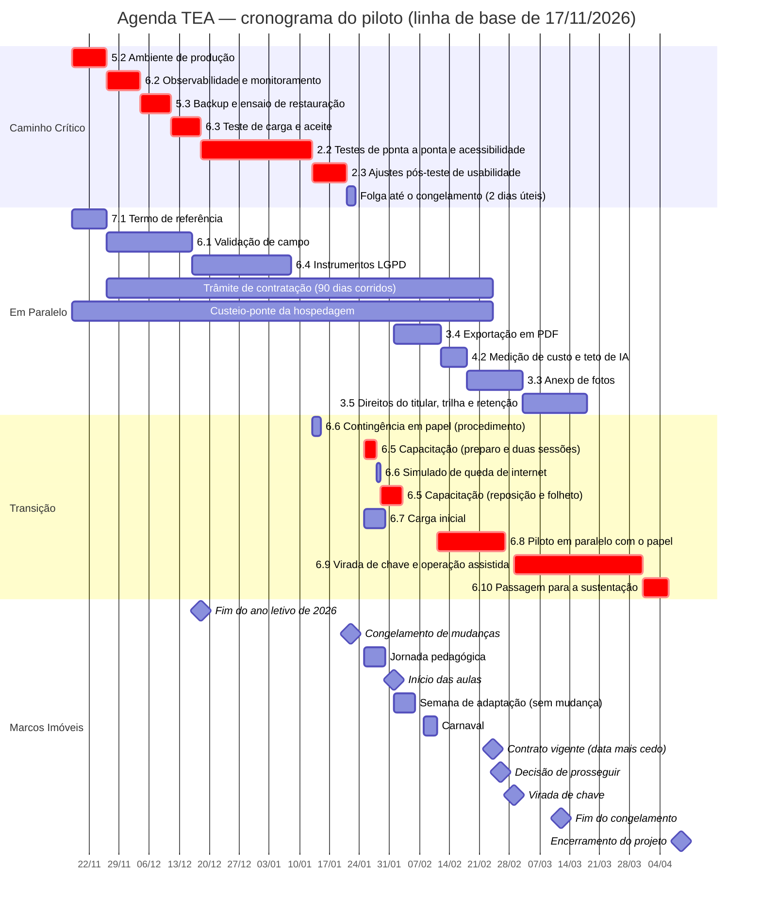

# Agenda TEA — Plano de Projeto (Etapa 2: do projeto ao plano de projeto)

**Disciplina:** Projetos de Sistemas
**Instituição:** CIESA — Centro Universitário de Ensino Superior do Amazonas
**Curso:** Análise e Desenvolvimento de Sistemas
**Aluno:** Carlos Cândido · 25000656@estudante.ciesa.br
**Referência:** PMBOK 7ª edição · documento da Etapa 1 (Levantamento de Requisitos e Arquitetura Cliente-Servidor)
**Data de corte do plano:** 17 de novembro de 2026

---

## Como ler este plano

**O que está sendo planejado.** Este plano não projeta um sistema novo: ele converte a arquitetura da Etapa 1 no projeto que a entrega. Como o Agenda TEA é um sistema real, parte dessa arquitetura já foi construída e verificada em laboratório entre 25/08 e 17/11/2026. O plano trata esse trabalho como **realizado** (seção 1.1, pacotes ✅, com a data do commit que o concluiu na `main`) e estabelece a linha de base para o que a arquitetura **ainda deve**: fechar a construção, contratar o que a arquitetura manda comprar e substituir a agenda de papel no Centro de Educação Especial Maria das Graças, em Manaus.

**Regra de rastreabilidade.** Todo pacote, prazo, custo, risco, aquisição e papel deste documento cita o ADR, o componente C4 ou o requisito da Etapa 1 que o originou. O que não tem origem na Etapa 1 ficou fora da linha de base e está declarado como tal (seção 1.3). A correspondência entre esses identificadores e os do repositório está na seção 2.6 da Etapa 1.

**Regra das premissas.** Todo número vem com a premissa que o sustenta. As premissas são numeradas (`PR-nn`) e as que dependem de confirmação externa têm data-limite para confirmar.

### Premissas gerais

| ID    | Premissa                                                                                                                                                                                                                                                                   | Sustenta                                                       | Confirmar com / até                   |
| ----- | -------------------------------------------------------------------------------------------------------------------------------------------------------------------------------------------------------------------------------------------------------------------------- | -------------------------------------------------------------- | ------------------------------------- |
| PR-01 | O ano letivo de 2026 da instituição parceira termina em **18/12/2026**; a jornada pedagógica de 2027 ocorre de **25 a 29/01/2027**; as aulas começam em **01/02/2027**.                                                                                                    | Todos os marcos imóveis (seção 2.2)                            | Coordenação da escola, até 30/11/2026 |
| PR-02 | Calendário do projeto: segunda a sexta. Não contam como dias úteis: 20/11 e 08/12/2026, a pausa da equipe de 24/12/2026 a 03/01/2027, o carnaval (08 a 10/02/2027) e 26/03/2027. O congelamento de 22/01/2027 vale a partir do fim desse dia.                              | Datas do cronograma                                            | —                                     |
| PR-03 | A equipe executora tem **duas pessoas em dedicação parcial**: um dia do plano equivale a **4 horas efetivas** do responsável.                                                                                                                                              | Conversão de dias em horas e em custo                          | —                                     |
| PR-04 | O esforço é valorado a **R$ 60/h** (arquiteto e desenvolvedor), **R$ 45/h** (analista de requisitos e QA) e **R$ 30/h** (hora de profissional da escola). São valores de referência para medir custo econômico: a execução é extensionista, não remunerada.                | Seções 3 e 5                                                   | —                                     |
| PR-05 | Câmbio de **R$ 5,60 por US$ 1,00**, sem reajuste ao longo dos três anos.                                                                                                                                                                                                   | Custos de nuvem e de IA                                        | Sensibilidade na seção 3              |
| PR-06 | Preços de tabela pública dos fornecedores: contêiner de aplicação a US$ 7/mês, PostgreSQL gerenciado básico a US$ 19/mês, cópia externa em armazenamento de objetos a US$ 1/mês, modelo de linguagem a US$ 3 por milhão de tokens de entrada e US$ 15 por milhão de saída. | Seção 3                                                        | Conferir na data da contratação       |
| PR-07 | Escala do piloto: **1 escola, 90 alunos, 19 profissionais** (dado da Etapa 1) e 200 dias letivos por ano.                                                                                                                                                                  | Volume de IA, capacitação, carga inicial                       | —                                     |
| PR-08 | A natureza jurídica da instituição parceira não está documentada. O plano adota o **pior caso**: contratação sujeita à Lei nº 14.133/2021.                                                                                                                                 | Seção 6                                                        | Direção da escola, até 30/11/2026     |
| PR-09 | O piloto começa com o **módulo de IA desligado** para a escola e com **uma réplica** da API, que executa também o processador assíncrono no mesmo processo (Etapa 1, Nível 2).                                                                                             | Riscos R2 e R7; custo de IA como teto; dois contêineres no TCO | —                                     |

---

## 0. Tabela de impacto das decisões arquiteturais (seis ângulos)

| Decisão (ADR)                                                                 | Escopo (cria / elimina)                                                                                                                                                                                                                                                                                   | Cronograma (dependências / caminho crítico)                                                                                                                                                                                                                                   | Custo (implantação vs. 3 anos)                                                                                                                            | Riscos (mitiga / cria)                                                                                                                                                                                                                                                                 | Aquisições (construir vs. comprar)                                                                                                               | Equipe (competência / operação)                                                                                                                                                                  |
| ----------------------------------------------------------------------------- | --------------------------------------------------------------------------------------------------------------------------------------------------------------------------------------------------------------------------------------------------------------------------------------------------------- | ----------------------------------------------------------------------------------------------------------------------------------------------------------------------------------------------------------------------------------------------------------------------------- | --------------------------------------------------------------------------------------------------------------------------------------------------------- | -------------------------------------------------------------------------------------------------------------------------------------------------------------------------------------------------------------------------------------------------------------------------------------- | ------------------------------------------------------------------------------------------------------------------------------------------------ | ------------------------------------------------------------------------------------------------------------------------------------------------------------------------------------------------ |
| **ADR-001** — PostgreSQL relacional com Prisma                                | **Cria:** 5.3 (backup e ensaio de restauração), a aplicação das _migrations_ em produção (dentro de 5.2) e a carga atômica por planilha (6.7). **Elimina:** código de compensação para importação parcial e uma segunda trilha de auditoria fora da transação.                                            | Banco antes da API (já cumprida). **5.3 antes de 6.7:** nenhum dado real entra antes de a restauração ter sido ensaiada. Como toda mudança de campo exige _migration_ e novo _deploy_ (consequência negativa do ADR), o plano fixa um **congelamento de 22/01 a 12/03/2027**. | Implantação: 5.3 custa 3,33 dias (R$ 800). Três anos: banco gerenciado a US$ 19/mês = **R$ 3.830**.                                                       | **Mitiga:** registro de saúde gravado sem a prova de quem o gravou (RNF07). **Cria:** R8 (campo novo exigido pela escola em pleno piloto) e a dívida da versão fixada do Prisma.                                                                                                       | **Comprar** o PostgreSQL gerenciado; **construir** esquema, _migrations_ e repositórios. A dependência é do motor PostgreSQL, não do fornecedor. | Modelagem relacional e _migrations_ (o desenvolvedor tem). Operação: o provedor cuida do banco; a equipe ensaia a restauração a cada trimestre.                                                  |
| **ADR-002** — Sessão em _cookies_ `httpOnly`, JWT curto, _refresh_ rotativo   | **Cria:** domínio próprio único com PWA e API no mesmo site sob HTTPS (dentro de 5.2) e o teste de login de ponta a ponta em produção (dentro de 2.2). **Elimina:** o armazenamento de sessão compartilhado e a sua operação.                                                                             | **Domínio definitivo antes da primeira instalação do PWA** (5.2 antes de 6.5): a origem instalada nos aparelhos e as assinaturas de notificação ficam presas ao domínio. Põe 5.2 na cabeça do caminho crítico.                                                                | Implantação: domínio a R$ 40. Três anos: R$ 120 de domínio; evita um armazenamento de sessão gerenciado (premissa de US$ 10/mês = R$ 2.016 em três anos). | **Mitiga:** roubo de sessão por XSS sobre dado de saúde de criança. **Cria:** R7 (configuração de mesmo site errada derruba o login), a janela de 15 minutos de um _token_ já emitido e a necessidade de propagar o IP do aparelho até a API para o limite de tentativas valer por IP. | **Comprar** o registro do domínio; **construir** a autenticação (já construída).                                                                 | _Cookies_, CORS e CSP (o desenvolvedor tem). Operação: renovação anual do domínio, sob responsabilidade do patrocinador.                                                                         |
| **ADR-003** — Nuvem gerenciada e containerizada, em vez de servidor na escola | **Cria:** 5.2 (ambiente de produção), 6.2 (observabilidade), 6.3 (teste de carga medido de Manaus), 6.4 (cláusula de transferência de dados e termo), 6.6 (contingência em papel) e 7.1 (termo de referência). **Elimina:** servidor físico, _nobreak_, enlace redundante e visitas técnicas (seção 1.3). | 7.1 abre um trâmite de **90 dias corridos**, contornado por custeio-ponte (seção 6.2). O caminho crítico começa em 5.2. A capacitação (6.5) só existe como pacote crítico porque a escola não tem equipe de TI.                                                               | Implantação: R$ 666 de custeio-ponte, contra R$ 18.100 de equipamento na alternativa rejeitada. Três anos: **R$ 6.854** de hospedagem e banco.            | **Mitiga:** indisponibilidade por energia, enlace ou _hardware_ da escola (RNF05). **Cria:** R1 (sem internet a escola fica sem o plano de medicação), R5 (contratação), R10 (latência da região de hospedagem) e a dependência de fornecedor.                                         | **Comprar** hospedagem, banco, e-mail transacional, armazenamento de objetos e modelo de linguagem; **construir** o que é regra do negócio.      | Docker e integração contínua (o desenvolvedor tem). Operação: primeiro nível na coordenação da escola, segundo nível na equipe do projeto (8 h/mês); nenhum administrador de servidor na escola. |

---

## 1. Escopo — Estrutura Analítica do Projeto (EAP)

### 1.1 Diagrama da EAP

```mermaid
---
title: "EAP do Projeto Piloto Agenda TEA — três níveis"
---
flowchart TD
    P["<b>0. PROJETO PILOTO AGENDA TEA</b><br/>da arquitetura da Etapa 1 ao primeiro cliente em operação"]

    P --> F1["<b>1. Gestão do projeto</b>"]
    P --> F2["<b>2. Aplicação Cliente (PWA)</b><br/><i>contêiner C4</i>"]
    P --> F3["<b>3. Servidor de Aplicação / API</b><br/><i>contêiner C4</i>"]
    P --> F4["<b>4. Processador Assíncrono</b><br/><i>contêiner C4, no processo da API</i>"]
    P --> F5["<b>5. Banco de Dados e Infraestrutura</b><br/><i>contêiner C4 · ADR-001 · ADR-003</i>"]
    P --> F6["<b>6. Transição</b><br/><i>trabalho que não é código novo</i>"]
    P --> F7["<b>7. Aquisições</b><br/><i>sistemas externos do Nível 1</i>"]

    F1 --> G11["1.1 Linha de base e portões"]
    F1 --> G12["1.2 Monitoramento, controle e encerramento"]

    F2 --> C21["2.1 Telas de registro, resumo, gestão, consentimento, white-label e TWA ✅"]
    F2 --> C22["2.2 Testes de ponta a ponta e acessibilidade no CI"]
    F2 --> C23["2.3 Ajustes pós-teste de usabilidade"]

    F3 --> C31["3.1 Domínio puro, autenticação, autorização, casos de uso e auditoria ✅"]
    F3 --> C32["3.2 Isolamento multi-tenant, plataforma SuperAdmin e feature flags ✅"]
    F3 --> C33["3.3 Anexo de fotos por URL assinada (pós-virada)"]
    F3 --> C34["3.4 Exportação do relatório semanal em PDF (pós-virada)"]
    F3 --> C35["3.5 Direitos do titular, consulta da trilha e retenção (pós-virada)"]

    F4 --> C41["4.1 Fila de notificações, alertas e geração de texto ✅"]
    F4 --> C42["4.2 Medição de custo e teto de IA (pós-virada)"]

    F5 --> C51["5.1 Esquema relacional, migrations e imagens Docker ✅"]
    F5 --> C52["5.2 Ambiente de produção"]
    F5 --> C53["5.3 Backup e ensaio de restauração"]

    F6 --> T61["6.1 Validação de campo"]
    F6 --> T62["6.2 Observabilidade e monitoramento"]
    F6 --> T63["6.3 Teste de carga e aceite de desempenho"]
    F6 --> T64["6.4 Instrumentos LGPD"]
    F6 --> T65["6.5 Capacitação da equipe escolar"]
    F6 --> T66["6.6 Contingência em papel e simulado"]
    F6 --> T67["6.7 Carga inicial"]
    F6 --> T68["6.8 Piloto em paralelo com o papel"]
    F6 --> T69["6.9 Virada de chave e operação assistida"]
    F6 --> T610["6.10 Passagem para a sustentação"]

    F7 --> A71["7.1 Termo de referência e contratação"]

    classDef feito fill:#c8e6c9,stroke:#2e7d32,color:#1b5e20
    classDef transicao fill:#fff8e1,stroke:#f9a825
    classDef posvirada fill:#f3e5f5,stroke:#7b1fa2,stroke-dasharray: 5 5
    classDef raiz fill:#1565c0,stroke:#0d47a1,color:#fff
    class C21,C31,C32,C41,C51 feito
    class T61,T62,T63,T64,T65,T66,T67,T68,T69,T610 transicao
    class C33,C34,C35,C42 posvirada
    class P raiz
```



**Legenda:** azul é o projeto (nível 1); as sete caixas seguintes são as frentes (nível 2) — quatro contêineres do diagrama C4 de Nível 2, mais gestão, transição e aquisições; as demais são pacotes de trabalho (nível 3). Verde com ✅ é pacote **realizado antes da data de corte**; amarelo é pacote de **transição**; lilás tracejado é construção **pós-virada**: desenvolvida em fevereiro e março, publicada só depois do congelamento e sem bloquear o piloto (6.8) nem a virada (6.9).

**Pacotes realizados (fora da linha de base, mantidos na EAP para que todo contêiner da Etapa 1 apareça):**

| ID        | Pacote                                                                                                                                                         | Origem na Etapa 1                                                       | Concluído na `main` em |
| --------- | -------------------------------------------------------------------------------------------------------------------------------------------------------------- | ----------------------------------------------------------------------- | ---------------------- |
| 3.1       | Domínio puro, autorização por papel e por vínculo, regras de sessão                                                                                            | Componentes Domínio Puro e Autorização (Nível 3)                        | 08/09/2026             |
| 5.1       | Esquema relacional, _migrations_ e testes de integração em PostgreSQL real                                                                                     | ADR-001 · contêiner Banco de Dados                                      | 12/09/2026             |
| 3.1 / 4.1 | Sessão em _cookie_ `httpOnly`, confirmação de leitura e alertas críticos                                                                                       | ADR-002 · componentes Autenticação e Auditoria · Processador Assíncrono | 14/09/2026             |
| 2.1       | Telas de crise, medicação e resumo do dia                                                                                                                      | Contêiner Aplicação Cliente (PWA)                                       | 15/09/2026             |
| 3.1 / 2.1 | Gestão da unidade, convite de primeiro acesso e importação por CSV                                                                                             | RF15, RF16, RF17                                                        | 22/10/2026             |
| 3.1 / 2.1 | Consentimento LGPD versionado, com bloqueio global                                                                                                             | RF08 · componente Conformidade LGPD                                     | 23/10/2026             |
| 5.1       | Imagens Docker _multi-stage_ e composição de produção                                                                                                          | ADR-003                                                                 | 23/10/2026             |
| 2.1       | Empacotamento do PWA como TWA (`.apk` assinado e `assetlinks.json`), distribuído fora de loja                                                                  | RNF06 · contêiner Aplicação Cliente (PWA)                               | 24/10/2026             |
| 5.1       | Descritor de implantação em nuvem e _migrations_ por integração contínua                                                                                       | ADR-003                                                                 | 25/10/2026             |
| 5.1 / 3.2 | Fundação de dados _multi-tenant_: unidade como locatário, identidade e configuração da escola, _migrations_ M1 a M3                                            | RNF09 · ADR-001                                                         | 12/11/2026             |
| 3.2       | Isolamento de dados por unidade escolar via ALS e extensão Prisma _fail-closed_                                                                                | RNF04, RNF09 · Repositórios Escopados                                   | 12/11/2026             |
| 3.2       | Módulo de Plataforma (`SUPER_ADMIN`, _migration_ M4), personalização com imagens da marca em `bytea`, rotas públicas de tema e `ModuloGuard` (_feature flags_) | RF01, RF15, RF19, RN06 · Autorização e Módulos contratados              | 12/11/2026             |
| 2.1       | Interface _white-label_ com tokens CSS no servidor, contraste WCAG AA e painéis de personalização e de plataforma                                              | RF15, RNF03 · Contêiner Aplicação Cliente (PWA)                         | 17/11/2026             |

Estado medido no repositório na data de corte (17/11/2026): **981 testes automatizados** passando (399 domínio, 419 API, 163 PWA), cobertura do domínio de 98% das instruções e 92,8% dos ramos, e nenhum erro de análise estática ou de tipos.

### 1.2 Pacotes de transição obrigatórios

| Exigência                           | Pacotes                                                                                             | Por que a arquitetura os cria                                                                                                                                                                                 |
| ----------------------------------- | --------------------------------------------------------------------------------------------------- | ------------------------------------------------------------------------------------------------------------------------------------------------------------------------------------------------------------- |
| **Capacitação**                     | 6.5 Capacitação da equipe escolar                                                                   | O ADR-003 parte de uma instituição com 19 profissionais e nenhuma equipe de TI, e o RNF02 exige preenchimento em até 2 minutos. Sem treino, o tempo medido em campo é o da primeira vez, não o do uso.        |
| **Observabilidade e monitoramento** | 6.2 Observabilidade · 6.3 Teste de carga                                                            | O RNF05 promete 99% na janela escolar e o RNF01 promete p95: sem medição externa, as duas metas são declaração. A consequência negativa do ADR-003 manda medir o RNF01 com clientes reais em Manaus.          |
| **Migração e implantação**          | 6.7 Carga inicial · 6.8 Piloto em paralelo · 6.9 Virada de chave · 6.10 Passagem para a sustentação | A agenda de papel é substituída aos poucos: primeiro uma turma, com papel e sistema lado a lado; depois todas, com o papel reduzido à contingência do plano de medicação (6.6).                               |
| **Conformidade**                    | 6.4 Instrumentos LGPD · 6.6 Contingência em papel · 3.5 Direitos do titular                         | Duas consequências negativas do ADR-003 viram trabalho: o dado passa a residir fora da instituição, e a escola sem internet fica sem o sistema. E os direitos do titular (RF13) ainda não têm rota no código. |

### 1.3 Pacotes e custos que a arquitetura eliminou

| Eliminado                                           | Decisão que eliminou                                           | O que deixou de existir                                                                                                                                                       | Valor evitado                                                                   |
| --------------------------------------------------- | -------------------------------------------------------------- | ----------------------------------------------------------------------------------------------------------------------------------------------------------------------------- | ------------------------------------------------------------------------------- |
| **Servidor físico na escola**                       | ADR-003                                                        | Compra de servidor, _nobreak_, _rack_, enlace com IP fixo e enlace redundante, cópia de segurança externa, visitas técnicas e administração de sistema operacional            | R$ 18.100 no Ano 0 e cerca de R$ 10.800 por ano de operação (seção 3)           |
| **Dois aplicativos nativos (iOS e Android)**        | RNF06 (PWA sem loja de aplicativos)                            | Duas bases de código de cliente, contas de desenvolvedor nas lojas e ciclos de revisão a cada versão. O `.apk` existente é uma casca TWA do mesmo PWA, não um segundo cliente | Não quantificado no plano: é uma frente inteira de construção que a EAP não tem |
| **Armazenamento de sessão compartilhado**           | ADR-002                                                        | Um serviço a mais para contratar, monitorar e manter                                                                                                                          | R$ 2.016 em três anos (premissa de US$ 10/mês)                                  |
| **Sincronização de dados sem conexão**              | Nível 2 da Etapa 1 (o Service Worker não guarda dado de saúde) | Fila local de registros, resolução de conflito e cifragem de dado de saúde no aparelho                                                                                        | Não quantificado; em troca, a decisão **cria** o pacote 6.6                     |
| **Contêiner próprio para o processador assíncrono** | Nível 2 da Etapa 1 (laços no processo da API)                  | Um terceiro serviço a hospedar no piloto                                                                                                                                      | US$ 7/mês, cerca de R$ 470 por ano                                              |
| **Componente de pagamentos**                        | Modelo de negócio B2B da Etapa 1                               | Integração com _gateway_ e tratamento de dado financeiro ao lado de dado de saúde                                                                                             | Não quantificado                                                                |

**Programado para depois da virada, com origem na Etapa 1.** Três pacotes estão na linha de base, mas são construídos em fevereiro e março e publicados só depois do fim do congelamento (12/03): **3.3** (anexo de fotos, RF21), **3.4** (relatório semanal em PDF, RF12) e **3.5** (rotas de exportação e exclusão do titular — RF13 e a parte LGPD de RF19 —, consulta da trilha pela coordenação — RF18 — e job de anonimização ao fim dos 5 anos — RN08). Nenhum deles bloqueia o piloto em paralelo (6.8) nem a virada (6.9). Até 3.5 entrar em produção, o pedido de titular e a consulta à trilha são atendidos pelo segundo nível, por procedimento manual documentado (pedido registrado pelo encarregado de dados, execução pelo desenvolvedor, data e executor anotados); a anonimização de RN08 só produz efeito em 2032, cinco anos depois da entrada dos primeiros dados reais.

**Fora da linha de base por não ter origem na Etapa 1:** o manifesto web dinâmico por escola para o empacotamento multi-APK (o `.apk` TWA e o `assetlinks.json` já existem; falta o manifesto que troca nome e ícone conforme a escola, Sprint 5 do plano interno), a publicação na Google Play Store e o canal de mensagens entre família e equipe — a tabela `mensagem` e o módulo `CHAT` existem só como estrutura, sem rota nem tela, e nenhum requisito da Etapa 1 o pede. Entrariam por controle de mudanças, consumindo reserva gerencial.

### 1.4 Dicionário da EAP

Estimativas em dias úteis de duração (PR-03). `PERT = (O + 4M + P) / 6`.

| ID   | Pacote                                             | Entrega                                                                                                                                                                                                                    | Decisão-origem                                                                            | Responsável                                                         | Estimativa (O · M · P → PERT) | Depende de                    | Habilita                              |
| ---- | -------------------------------------------------- | -------------------------------------------------------------------------------------------------------------------------------------------------------------------------------------------------------------------------- | ----------------------------------------------------------------------------------------- | ------------------------------------------------------------------- | ----------------------------- | ----------------------------- | ------------------------------------- |
| 5.2  | Ambiente de produção                               | Plano pago sem hibernação, domínio próprio com PWA e API no mesmo site sob HTTPS, IP do aparelho propagado até a API, segredos fora da imagem, _migrations_ aplicadas                                                      | ADR-003 · ADR-002                                                                         | Arquiteto e desenvolvedor                                           | 3 · 5 · 10 → **5,50**         | —                             | 6.2, 5.3, 6.5                         |
| 6.2  | Observabilidade e monitoramento                    | Sonda externa a cada minuto na janela de 07h às 19h, captura de erros, p95 por rota e alerta ao responsável técnico                                                                                                        | ADR-003 · RNF05 · RNF01                                                                   | Arquiteto e desenvolvedor                                           | 4 · 6 · 12 → **6,67**         | 5.2                           | 6.3, 6.8                              |
| 5.3  | Backup e ensaio de restauração                     | Cópia lógica diária fora do provedor e uma restauração completa cronometrada e documentada                                                                                                                                 | ADR-001 · RN08 · RNF07                                                                    | Arquiteto e desenvolvedor                                           | 2 · 3 · 6 → **3,33**          | 5.2                           | 6.7                                   |
| 6.3  | Teste de carga e aceite de desempenho              | Relatório com p95 das três operações do RNF01, medido de Manaus em rede 4G, no volume de 50 unidades do RNF09                                                                                                              | RNF01 · RNF09 · ADR-003                                                                   | Arquiteto e desenvolvedor                                           | 3 · 4 · 9 → **4,67**          | 6.2                           | Congelamento                          |
| 2.2  | Testes de ponta a ponta e acessibilidade no CI     | Fluxos críticos automatizados e axe-core como portão: nenhuma violação crítica passa                                                                                                                                       | Contêiner PWA · RNF03 · RNF08                                                             | Arquiteto e desenvolvedor, com verificação manual do analista de QA | 6 · 10 · 20 → **11,00**       | —                             | Congelamento                          |
| 2.3  | Ajustes pós-teste de usabilidade                   | Correções priorizadas do teste de campo, com nova medição do tempo de preenchimento                                                                                                                                        | Contêiner PWA · RNF02                                                                     | Arquiteto e desenvolvedor                                           | 2 · 5 · 12 → **5,67**         | 6.1                           | Congelamento                          |
| 7.1  | Termo de referência e contratação                  | Estudo preliminar, termo de referência e três cotações protocolados; em seguida, o trâmite de 90 dias                                                                                                                      | ADR-003 · sistemas externos do Nível 1                                                    | Analista de requisitos e QA, com patrocinador                       | 3 · 5 · 10 → **5,50**         | —                             | 6.1 (mesma pessoa) · contrato vigente |
| 6.1  | Validação de campo                                 | Entrevistas de confirmação das premissas de uso e teste de usabilidade com ao menos 5 profissionais: tempo de preenchimento e nota SUS                                                                                     | RNF02                                                                                     | Analista de requisitos e QA                                         | 8 · 12 · 20 → **12,67**       | 7.1 (mesma pessoa)            | 2.3, 6.4                              |
| 6.4  | Instrumentos LGPD                                  | Relatório de impacto, contrato com cláusula de transferência de dados e termo de consentimento revisado e assinado pela direção                                                                                            | ADR-003 (consequência negativa) · RN02                                                    | Analista de requisitos e QA, com encarregado de dados               | 5 · 8 · 18 → **9,17**         | 6.1 (mesma pessoa)            | 6.7, 4.2, 3.3, 3.5                    |
| 6.5  | Capacitação da equipe escolar                      | Guia de uma página, duas sessões práticas de 2 horas para os 19 profissionais e folheto para as famílias                                                                                                                   | ADR-003 (escola sem TI) · RNF02                                                           | Analista de requisitos e QA, com ponto focal da escola              | 4 · 6 · 10 → **6,33**         | 5.2 · Congelamento            | 6.8                                   |
| 6.6  | Contingência em papel e simulado                   | Folha diária do plano de medicação, procedimento de uma página e um simulado de queda de internet                                                                                                                          | ADR-003 (consequência negativa)                                                           | Analista de requisitos e QA, com ponto focal da escola              | 1 · 2 · 4 → **2,17**          | —                             | 6.8                                   |
| 6.7  | Carga inicial                                      | Turmas, crianças e responsáveis importados por planilha, planos de medicação transcritos pela coordenação e convites enviados                                                                                              | RF16 · RF17 · RN01 · ADR-001                                                              | Arquiteto e desenvolvedor, com ponto focal da escola                | 2 · 4 · 9 → **4,50**          | 5.3, 6.4                      | 6.8                                   |
| 6.8  | Piloto em paralelo com o papel                     | Uma turma usando papel e sistema por duas semanas letivas; decisão de prosseguir ou não registrada                                                                                                                         | Todos os contêineres do Nível 2 · RNF02 · RNF05                                           | Analista de requisitos e QA, com ponto focal da escola              | 8 · 10 · 20 → **11,33**       | 6.5, 6.6, 6.7, 6.2            | 6.9                                   |
| 6.9  | Virada de chave e operação assistida               | Todas as turmas no sistema, papel restrito à contingência, quatro semanas de acompanhamento                                                                                                                                | Todos os contêineres do Nível 2 · RN07                                                    | Analista de requisitos e QA, com plantão do desenvolvedor           | 15 · 20 · 30 → **20,83**      | 6.8                           | 6.10                                  |
| 6.10 | Passagem para a sustentação                        | Roteiro de operação, acessos transferidos, primeiro nível assumido pela coordenação e lições aprendidas                                                                                                                    | ADR-003 · ADR-002                                                                         | Arquiteto e desenvolvedor                                           | 2 · 3 · 6 → **3,33**          | 6.9                           | Encerramento                          |
| 3.4  | Exportação do relatório semanal em PDF             | Relatório aprovado exportável em PDF pelo responsável (a exportação do texto aprovado já existe)                                                                                                                           | RF12 · componente Casos de Uso                                                            | Arquiteto e desenvolvedor                                           | 3 · 5 · 10 → **5,50**         | — (publicado só após 12/03)   | —                                     |
| 4.2  | Medição de custo e teto de IA                      | Custo por texto gerado registrado e teto mensal que desliga a geração ao ser atingido                                                                                                                                      | Componente AdaptadorAnthropic · RF14 · RNF05                                              | Arquiteto e desenvolvedor                                           | 2 · 3 · 6 → **3,33**          | 6.4                           | Ligar IA para a escola                |
| 3.3  | Anexo de fotos por URL assinada                    | Porta de armazenamento, adaptador S3 e tela de envio; o binário não passa pelo servidor                                                                                                                                    | RF21 · componente AdaptadorS3 (Nível 3, a construir) · contêiner Armazenamento de Objetos | Arquiteto e desenvolvedor                                           | 5 · 8 · 16 → **8,83**         | 6.4                           | —                                     |
| 3.5  | Direitos do titular, consulta da trilha e retenção | Rotas de exportação (JSON e legível) e de exclusão ou anonimização sob pedido, revogação do consentimento pelo próprio responsável, consulta da trilha da unidade pela coordenação e job de anonimização ao fim dos 5 anos | RF13 · RF18 · RF19 · RN08 · RNF07 · componente Conformidade LGPD                          | Arquiteto e desenvolvedor                                           | 6 · 10 · 20 → **11,00**       | 6.4 (publicado só após 12/03) | Encerramento                          |

---

## 2. Cronograma e caminho crítico

### 2.1 Matriz de dependências arquiteturais

| #   | Dependência                                                    | Por quê?                                                                                                                                                                                                                  |
| --- | -------------------------------------------------------------- | ------------------------------------------------------------------------------------------------------------------------------------------------------------------------------------------------------------------------- |
| D1  | Domínio puro e banco **antes** da API _(cumprida em set/2026)_ | Os casos de uso recebem as portas pelo construtor e os repositórios derivam os tipos do esquema: sem os dois, a API não compila.                                                                                          |
| D2  | 5.2 **antes** de 6.2                                           | Só se monitora o que existe: a sonda externa mede o endereço definitivo de produção, não o de laboratório.                                                                                                                |
| D3  | 6.2 **antes** de 6.3                                           | Teste de carga sem p95 por rota medido é teste sem resultado. A observabilidade é o instrumento; a carga, o experimento.                                                                                                  |
| D4  | 5.2 **antes** de 6.5                                           | O ADR-002 prende a sessão ao mesmo site: o PWA instalado e as assinaturas de notificação ficam ligados ao domínio. Treinar em um endereço e operar em outro obrigaria a reinstalar o aplicativo em todos os aparelhos.    |
| D5  | 5.3 **antes** de 6.7                                           | Nenhum dado de criança real entra em um banco cuja restauração nunca foi ensaiada (RN08, RNF07).                                                                                                                          |
| D6  | 6.4 **antes** de 6.7                                           | A RN02 exige consentimento específico, e o ADR-003 pôs o dado fora da instituição: o termo precisa dizer isso antes do primeiro convite a uma família.                                                                    |
| D7  | 6.1 **antes** de 2.3                                           | Os ajustes de usabilidade são definidos pelo que o teste de campo mede.                                                                                                                                                   |
| D8  | 6.3, 2.2 e 2.3 **antes** do congelamento                       | O congelamento só protege a escola se o que foi congelado já passou por desempenho, acessibilidade e usabilidade.                                                                                                         |
| D9  | Congelamento **antes** de 6.5                                  | Treina-se a versão que entra em operação. Tela que muda depois do treino desfaz o treino — por isso nem o material de 6.5 começa antes de 25/01.                                                                          |
| D10 | 6.5 e 6.6 **antes** de 6.8                                     | Capacitação antes do primeiro uso real; contingência em papel antes do primeiro dado real de medicação.                                                                                                                   |
| D11 | 6.8 **antes** de 6.9                                           | A virada de todas as turmas depende da decisão registrada ao fim do piloto com uma turma.                                                                                                                                 |
| D12 | 7.1 **antes** do contrato, com 90 dias de espera               | Prazo legal (seção 6.2). Não bloqueia 5.2 por causa do custeio-ponte.                                                                                                                                                     |
| D13 | 6.4 **antes** de 4.2, 3.3 e 3.5                                | Texto gerado por IA e foto de criança ampliam o tratamento de dado sensível: entram só depois do relatório de impacto. A exclusão e a anonimização de 3.5 dependem da base legal e do prazo declarados no termo revisado. |

### 2.2 Caminho crítico e paralelismo

**Sequência exata do caminho crítico:**

`5.2 Ambiente de produção → 6.2 Observabilidade → 5.3 Backup e ensaio de restauração → 6.3 Teste de carga → 2.2 Testes de ponta a ponta e acessibilidade → 2.3 Ajustes pós-teste de usabilidade → [Congelamento, 22/01] → 6.5 Capacitação → [Início das aulas, 01/02] → 6.8 Piloto em paralelo → [Decisão, 26/02] → 6.9 Virada de chave e operação assistida → 6.10 Passagem para a sustentação`

Soma PERT do caminho: **78,7 dias úteis**, com desvio-padrão de 4,9 dias. A soma é de durações, não de calendário: entre 6.5 e 6.8 os marcos imóveis (semana de adaptação e carnaval) acrescentam espera que não é trabalho.

**Por que 5.3 e 2.2 estão na sequência.** As dependências lógicas são 5.2 → 6.2 → 6.3 e 6.1 → 2.3. Os pacotes 5.3 e 2.2, e a posição de 2.3 depois de 2.2, entram na corrente porque todos são executados pela **mesma pessoa**: o plano não acrescenta desenvolvedores (seção 7.2), então a restrição de recurso serializa o trabalho técnico.

**Por que 6.7 não está na sequência.** A carga inicial depende de 5.3 e 6.4, não de 6.5, e é executada pelo desenvolvedor enquanto o analista conduz a capacitação. Os dois correm em paralelo na jornada pedagógica (25 a 29/01), e 6.7 tem 1,8 dia de folga em relação a 6.5.

**Folga até o congelamento.** Entre 18/11/2026 e 22/01/2027 há **39 dias úteis** (PR-02, contando os dois extremos). A corrente técnica soma 36,8 dias em valor PERT, com desvio-padrão de 3,6 dias. A folga de **2,2 dias úteis** equivale a 0,6 desvio-padrão, o que dá cerca de **73% de probabilidade** de chegar ao congelamento na data. É uma folga estreita, e o plano responde a ela em dois lugares: o gatilho de R6 dispara já com 1 dia útil de atraso, e 2.3 é o primeiro pacote a ser reduzido. Essa folga é a reserva de contingência de prazo (seção 5.2).

**O que roda em paralelo, e com quem:**

| Frente                | Pacotes                                            | Quem executa                                               | Por que pode ser paralela                                                                                                                                                       |
| --------------------- | -------------------------------------------------- | ---------------------------------------------------------- | ------------------------------------------------------------------------------------------------------------------------------------------------------------------------------- |
| Campo e conformidade  | 7.1 → 6.1 → 6.4                                    | Analista de requisitos e QA, com a escola e o patrocinador | Não toca código. Os três são da mesma pessoa e por isso correm em série entre si, mas em paralelo à corrente técnica                                                            |
| Contratação           | Trâmite de 90 dias após o protocolo de 7.1 (26/11) | Patrocinador                                               | É espera, não esforço: corre do protocolo até o contrato                                                                                                                        |
| Preparo da transição  | Procedimento de 6.6                                | Analista de requisitos e QA                                | Produzido em janeiro (13 a 15/01), enquanto o desenvolvedor fecha 2.2 e 2.3. O material de 6.5 só começa depois do congelamento (D9)                                            |
| Jornada pedagógica    | 6.5 e 6.7                                          | Analista (6.5) e desenvolvedor (6.7)                       | Pessoas diferentes e sem dependência entre os dois pacotes                                                                                                                      |
| Construção pós-virada | 3.4, 4.2, 3.3 e 3.5                                | Arquiteto e desenvolvedor, em fevereiro e março            | Desenvolvidos em ramo separado durante o congelamento e publicados só depois de 12/03. **3.4, 4.2 e 3.3 são o primeiro escopo a ser cortado**; 3.5 não, por ser obrigação legal |

**Marcos imóveis (o calendário da escola, que o projeto não negocia):**

| Marco                     | Data                    | Natureza            | Consequência para o plano                                                                                                                                                                                                   |
| ------------------------- | ----------------------- | ------------------- | --------------------------------------------------------------------------------------------------------------------------------------------------------------------------------------------------------------------------- |
| Fim do ano letivo de 2026 | 18/12/2026 (PR-01)      | Calendário escolar  | O teste de usabilidade (6.1) precisa de profissionais em serviço: ou acontece até esta data, ou só em fevereiro, depois do congelamento. Com 7.1 antes dele, 6.1 termina em 15/12 no valor PERT, a três dias úteis do marco |
| Jornada pedagógica        | 25 a 29/01/2027 (PR-01) | Calendário escolar  | Única janela em que os 19 profissionais estão reunidos sem crianças: as sessões de 6.5 e o simulado de 6.6 só cabem aqui                                                                                                    |
| Início das aulas          | 01/02/2027 (PR-01)      | Calendário escolar  | A primeira semana é de adaptação das crianças à rotina: **nenhuma mudança de processo** nela. A entrega do folheto às famílias (fim de 6.5) é comunicação, não mudança de processo                                          |
| Carnaval                  | 08 a 10/02/2027         | Feriado             | O piloto começa em 11/02                                                                                                                                                                                                    |
| Janela de congelamento    | 22/01 a 12/03/2027      | Derivada do ADR-001 | Só correção de defeito bloqueante entra em produção                                                                                                                                                                         |

Se a confirmação de PR-01 deslocar o início das aulas, todos os pacotes de transição se deslocam em bloco; o deslocamento para mais tarde aumenta a folga técnica, o para mais cedo aciona o risco R9.

### 2.3 Diagrama de Gantt



As barras usam data final exclusiva. A corrente técnica ocupa 37 dias úteis no calendário (de 18/11 a 20/01) e deixa 21 e 22/01 como folga até o congelamento.

---

## 3. Custo em três anos (TCO — implantação vs. operação)

As duas alternativas são as do **ADR-003** da Etapa 1. O _software_ é o mesmo nas duas; o que a decisão muda é onde ele roda e quem o opera. Por isso a construção já realizada é custo afundado comum e não entra na comparação, e o esforço de construção que ainda falta entra igual nas duas.

| Alternativa                                                                                                  | Premissas                                                                                                                                                                                                                                                            | Custo de implantação (Ano 0) | Operação anual (Ano 1 · Ano 2 · Ano 3) | Total acumulado em 3 anos |
| ------------------------------------------------------------------------------------------------------------ | -------------------------------------------------------------------------------------------------------------------------------------------------------------------------------------------------------------------------------------------------------------------- | ---------------------------- | -------------------------------------- | ------------------------- |
| **A — Arquitetura escolhida:** nuvem gerenciada e containerizada, PWA, PostgreSQL gerenciado, IA sob demanda | PR-03 a PR-07 e PR-09. Dois contêineres (a API, com o processador assíncrono no mesmo processo, e o PWA), um banco gerenciado e a cópia externa (US$ 34/mês). IA no **teto**: 18.000 resumos e 3.600 relatórios por ano. Sustentação de 8 h/mês.                     | **R$ 41.806**                | R$ 12.298 · R$ 12.298 · R$ 12.298      | **R$ 78.700**             |
| **B — Alternativa rejeitada:** servidor próprio dentro da escola                                             | As mesmas, mais: equipamento de R$ 18.100 (servidor a R$ 14.000, _nobreak_ a R$ 2.500, _rack_, _switch_ e cabeamento a R$ 1.600), dois enlaces (R$ 250 e R$ 150 por mês), energia de 150 W contínuos a R$ 1,00/kWh, administração de 16 h/mês e seis visitas por ano | **R$ 60.800**                | R$ 23.087 · R$ 23.687 · R$ 23.887      | **R$ 131.461**            |

**Composição do Ano 0 da Alternativa A (linha de base do projeto):**

| Item                                   | Como foi calculado                                                                                                                  | Valor         |
| -------------------------------------- | ----------------------------------------------------------------------------------------------------------------------------------- | ------------- |
| Esforço do arquiteto e desenvolvedor   | 293 h dos pacotes (12 pacotes da seção 1.4, a 4 h por dia) mais 33 h de plantão no piloto e na virada, a R$ 60/h                    | R$ 19.580     |
| Esforço do analista de requisitos e QA | 143 h dos pacotes (7.1, 6.1, 6.4, 6.5 e 6.6) mais 66 h de acompanhamento em campo em 6.8 e 6.9, a R$ 45/h                           | R$ 9.420      |
| Gestão do projeto                      | 10% do esforço acima                                                                                                                | R$ 2.900      |
| Horas da escola                        | 19 profissionais × 4 h de capacitação, mais 40 h do ponto focal, a R$ 30/h                                                          | R$ 3.480      |
| Desembolsos                            | Custeio-ponte da hospedagem por 3,5 meses (R$ 666), domínio (R$ 40), material impresso (R$ 300) e apoio jurídico de 10 h (R$ 2.000) | R$ 3.006      |
| **Subtotal**                           |                                                                                                                                     | **R$ 38.386** |
| Reserva de contingência                | Seção 5.2                                                                                                                           | R$ 3.420      |
| **Linha de base de custo**             |                                                                                                                                     | **R$ 41.806** |

**Composição da operação anual da Alternativa A:**

| Item                                              | Como foi calculado                                                                           | Valor por ano |
| ------------------------------------------------- | -------------------------------------------------------------------------------------------- | ------------- |
| Hospedagem, banco e cópia externa                 | US$ 34/mês (dois contêineres a US$ 7, banco a US$ 19 e cópia externa a US$ 1) × 12 × R$ 5,60 | R$ 2.285      |
| Modelo de linguagem (teto)                        | 48,6 milhões de tokens de entrada e 9,72 milhões de saída = US$ 291,60                       | R$ 1.633      |
| Domínio                                           | Renovação anual                                                                              | R$ 40         |
| E-mail transacional, notificações e monitoramento | Camadas gratuitas; as notificações usam o protocolo aberto dos navegadores                   | R$ 0          |
| **Subtotal de desembolso**                        |                                                                                              | **R$ 3.958**  |
| Sustentação técnica                               | 8 h/mês a R$ 60/h                                                                            | R$ 5.760      |
| Primeiro nível na escola e reciclagem anual       | 4 h/mês do ponto focal, mais 2 h por profissional na jornada pedagógica                      | R$ 2.580      |
| **Operação anual**                                |                                                                                              | **R$ 12.298** |

O armazenamento de objetos para as fotos de RF21 só passa a existir com o pacote 3.3 e não está nesta tabela: a cópia externa de 5.3 é o único uso desse tipo de serviço no piloto, e já está nos US$ 34/mês.

### Análise crítica

**O custo relevante está na operação, e isso fica mais nítido quando se separa esforço de dinheiro.** No custo econômico, três anos de operação (R$ 36.894) se aproximam da implantação (R$ 41.806). No dinheiro que efetivamente sai do caixa, a relação se inverte: o Ano 0 desembolsa **R$ 3.006** e os três anos seguintes, **R$ 11.874** — a operação custa quase quatro vezes a implantação. Quem orça só o projeto orça um quinto da conta.

**A alternativa B custa 67% a mais (R$ 52.761 de diferença), e a diferença está quase toda na operação.** A implantação explica R$ 18.994 (dos quais R$ 18.100 de equipamento); os outros R$ 33.767 são três anos de enlaces, energia, visitas e do dobro de horas de administração. O servidor na escola não é mais caro porque a máquina é cara: é mais caro porque transfere para o projeto o trabalho que o provedor faz em escala.

**Como a arquitetura respeita o orçamento de uma instituição educacional em Manaus:**

1. **Não há investimento em equipamento.** O ADR-003 troca R$ 18.100 de compra, que uma instituição social dificilmente tem em caixa, por R$ 190 por mês.
2. **O maior item variável tem teto e interruptor.** A IA responde por 41% do desembolso anual, mas a Etapa 1 a manteve fora do caminho crítico (RNF05): o pacote 4.2 impõe teto mensal, e desligá-la reduz o desembolso a **R$ 2.325 por ano** sem tirar da família o resumo estruturado.
3. **O custo marginal de uma nova escola é baixo.** Uma segunda escola custa, na alternativa A, o seu próprio consumo de IA (R$ 1.633 no teto) e as suas horas de primeiro nível; na B, custaria outros R$ 18.100 de equipamento e cerca de R$ 13.000 por ano de operação técnica.
4. **O item mais frágil não é técnico.** R$ 5.760 dos R$ 12.298 anuais são horas de sustentação hoje prestadas por estudantes. A seção 7.1 trata isso como decisão em aberto, não como custo resolvido.

**Sensibilidade.** Uma alta de 20% no câmbio (PR-05) acrescenta R$ 784 por ano à alternativa A. Se o apoio jurídico for prestado pelo núcleo de prática jurídica da instituição de ensino, o desembolso do Ano 0 cai para R$ 1.006. Se o processador assíncrono for separado em contêiner próprio, a operação sobe cerca de R$ 470 por ano.

---

## 4. Estimativa dos pacotes com incerteza (PERT)

```text
PERT = (O + 4M + P) / 6          Desvio-padrão σ = (P − O) / 6
```

| ID e pacote                                  | O (dias) | M (dias) | P (dias) | PERT (dias) | Desvio (dias) | Justificativa da cauda pessimista                                                                                                                                                                                                           |
| -------------------------------------------- | -------- | -------- | -------- | ----------- | ------------- | ------------------------------------------------------------------------------------------------------------------------------------------------------------------------------------------------------------------------------------------- |
| 5.2 Ambiente de produção                     | 3        | 5        | 10       | 5,50        | 1,17          | O ADR-002 exige PWA e API no mesmo site: um erro de domínio, _proxy_ ou atributo de _cookie_ só aparece no navegador real, e a publicação em laboratório já exigiu correções sucessivas de configuração de implantação (R7).                |
| 6.2 Observabilidade e monitoramento          | 4        | 6        | 12       | 6,67        | 1,33          | O p95 por rota precisa de instrumentação que não existe hoje; se a camada gratuita da ferramenta não guardar histórico suficiente, é preciso trocar de ferramenta no meio do pacote.                                                        |
| 5.3 Backup e ensaio de restauração           | 2        | 3        | 6        | 3,33        | 0,67          | O ADR-001 pôs regras no próprio banco (gatilho de imutabilidade do termo, restrições): uma restauração que não as recria na ordem certa falha e precisa ser refeita.                                                                        |
| 6.3 Teste de carga e aceite                  | 3        | 4        | 9        | 4,67        | 1,00          | A hospedagem atual fica fora do país: se o p95 medido de Manaus em 4G passar de 2 s, o pacote absorve a troca de região e uma nova medição (R10).                                                                                           |
| 2.2 Testes de ponta a ponta e acessibilidade | 6        | 10       | 20       | 11,00       | 2,33          | O axe-core nunca rodou no projeto: violações críticas encontradas viram retrabalho de tela, e a equipe não tem prática de auditoria com leitor de tela.                                                                                     |
| 2.3 Ajustes pós-teste de usabilidade         | 2        | 5        | 12       | 5,67        | 1,67          | Se o teste medir mais de 2 minutos de preenchimento, o ajuste deixa de ser cosmético e vira redesenho do formulário de registro (R3).                                                                                                       |
| 6.1 Validação de campo                       | 8        | 12       | 20       | 12,67       | 2,00          | Fim de ano letivo: menos de 5 profissionais disponíveis ou sessões remarcadas empurram o teste contra o recesso de 18/12, e depois de 7.1 sobram só três dias úteis de margem.                                                              |
| 6.4 Instrumentos LGPD                        | 5        | 8        | 18       | 9,17        | 2,17          | O ADR-003 pôs o dado fora da instituição: a cláusula de transferência depende de revisão jurídica e de assinatura da direção, que não estão sob controle da equipe.                                                                         |
| 7.1 Termo de referência                      | 3        | 5        | 10       | 5,50        | 1,17          | Três cotações de serviço em nuvem com preço em dólar e cobrança por uso não cabem no modelo usual de pesquisa de preços e podem voltar para ajuste.                                                                                         |
| 6.5 Capacitação da equipe escolar            | 4        | 6        | 10       | 6,33        | 1,00          | A jornada pedagógica é a única janela: uma sessão perdida só se repõe com a escola em aula, turma a turma.                                                                                                                                  |
| 6.6 Contingência em papel e simulado         | 1        | 2        | 4        | 2,17        | 0,50          | Se o simulado mostrar que a folha diária não basta para a medicação do dia, o procedimento é refeito e ensaiado de novo.                                                                                                                    |
| 6.7 Carga inicial                            | 2        | 4        | 9        | 4,50        | 1,17          | A importação do ADR-001 é atômica, ou entra tudo ou nada: uma planilha da secretaria com e-mails ausentes ou duplicados é recusada inteira até ser limpa; e a RN01 exige a prescrição vigente de cada criança antes de transcrever o plano. |
| 6.8 Piloto em paralelo com o papel           | 8        | 10       | 20       | 11,33       | 2,00          | Decisão negativa ao fim das duas semanas: o ciclo se repete com os ajustes, dobrando a duração (R3).                                                                                                                                        |
| 6.9 Virada de chave e operação assistida     | 15       | 20       | 30       | 20,83       | 2,50          | Queda de internet na escola durante a janela aciona a contingência em papel e prolonga o acompanhamento até duas semanas sem ocorrência (R1).                                                                                               |
| 6.10 Passagem para a sustentação             | 2        | 3        | 6        | 3,33        | 0,67          | O ADR-002 deixou dois modos de sessão e o ADR-003 deixou a operação com a equipe: o roteiro só é aceito depois que a segunda pessoa executa uma publicação e uma restauração sozinha.                                                       |
| 3.4 Exportação em PDF                        | 3        | 5        | 10       | 5,50        | 1,17          | A geração de PDF dentro de contêiner depende de fontes e bibliotecas nativas ausentes da imagem _multi-stage_ enxuta do ADR-003.                                                                                                            |
| 4.2 Medição de custo e teto de IA            | 2        | 3        | 6        | 3,33        | 0,67          | O custo por texto depende de contagem de tokens informada pelo fornecedor; o cálculo muda se o adaptador for trocado (R2).                                                                                                                  |
| 3.3 Anexo de fotos                           | 5        | 8        | 16       | 8,83        | 1,83          | O envio direto do aparelho ao armazenamento depende de assinatura de URL e de regras de origem no fornecedor; e foto de criança amplia o tratamento de dado sensível.                                                                       |
| 3.5 Direitos do titular, trilha e retenção   | 6        | 10       | 20       | 11,00       | 2,33          | A exclusão atravessa as 26 tabelas, cujas chaves estrangeiras recusam apagamento em cascata, e precisa preservar a trilha mínima; a anonimização é irreversível e exige ensaio em cópia do banco antes de valer em produção.                |

**Leitura da tabela.** Os dois maiores desvios estão em pacotes cuja cauda é de **gente**, não de código: a revisão jurídica (6.4) e a adoção pela equipe escolar (6.8, 6.9). No trabalho técnico, os maiores são 2.2, pela competência ausente em auditoria de acessibilidade, e 3.5, pela irreversibilidade da anonimização — este último fora do caminho crítico. É por isso que a reserva de prazo foi posta antes do congelamento e que o piloto tem uma segunda rodada prevista.

---

## 5. Gestão de riscos, gatilhos e reservas

### 5.1 Registro de riscos

| ID  | Risco (em uma frase)                                                                                                                                     | Origem                                       | Resposta planejada                                                                                                                                                                      | Gatilho                                                                                                                                                                                                                                                      | Tipo de reserva                                                                          |
| --- | -------------------------------------------------------------------------------------------------------------------------------------------------------- | -------------------------------------------- | --------------------------------------------------------------------------------------------------------------------------------------------------------------------------------------- | ------------------------------------------------------------------------------------------------------------------------------------------------------------------------------------------------------------------------------------------------------------ | ---------------------------------------------------------------------------------------- |
| R1  | Uma queda de internet ou de energia na escola deixa a equipe sem acesso ao plano de medicação do dia, porque o PWA não guarda dado de saúde no aparelho. | Arquitetural (ADR-003 e Nível 2)             | **Mitigar:** folha diária do plano de medicação impressa pela coordenação no início do turno e simulado antes do piloto (6.6).                                                          | Duas falhas consecutivas da sonda externa (2 minutos) entre 07h e 19h: a coordenação passa à folha de contingência. **Três ocorrências em 30 dias** reabrem a decisão de não guardar dado no aparelho.                                                       | Contingência (6.6 está na linha de base); a reabertura da decisão usa reserva gerencial  |
| R2  | A IA fica indisponível, encarece ou gera frase sem lastro nos registros.                                                                                 | Arquitetural (componente AdaptadorAnthropic) | **Mitigar e aceitar:** o piloto começa com a IA desligada (PR-09); ao ligar, vale o teto de 4.2, e o resumo estruturado não depende dela (RNF05).                                       | Custo acumulado do mês acima de **R$ 160** (80% do teto de R$ 200), ou mais de **10%** dos textos da semana recusados pela verificação de fidelidade: a geração é desligada para a escola.                                                                   | Contingência                                                                             |
| R3  | As professoras não conseguem registrar em até 2 minutos e voltam ao papel.                                                                               | Equipe                                       | **Mitigar:** teste de usabilidade antes do recesso (6.1), ajustes (2.3), capacitação (6.5) e piloto com uma única turma antes da virada (6.8).                                          | No teste: mediana acima de **2 minutos** com ao menos 5 profissionais, ou **SUS abaixo de 75**. No piloto: rotina publicada até 19h em menos de **80%** dos dias da turma por 5 dias letivos seguidos — a decisão é negativa e o ciclo se repete.            | Contingência (segunda rodada do piloto: 10 dias e R$ 1.500)                              |
| R4  | Um dado sensível de criança é exposto, por acesso indevido ou por uso de dado real em ambiente gratuito e sem cópia de segurança.                        | Projeto                                      | **Evitar:** dado real só entra em produção paga, depois de 5.3 e 6.4. **Mitigar:** isolamento por unidade testado a cada alteração e plano de resposta a incidente.                     | Falha do teste de isolamento na integração contínua (bloqueia a publicação); mais de **5 acessos negados por dia** da mesma conta a dado de outra unidade; ou qualquer detecção de reúso de _refresh token_ — o plano de incidente é aberto em até 24 horas. | Contingência para a resposta; reserva gerencial se houver sanção ou exigência legal nova |
| R5  | A contratação da hospedagem não se conclui antes da virada de chave.                                                                                     | Projeto (ADR-003 e Lei nº 14.133/2021)       | **Mitigar:** termo de referência protocolado na primeira semana e custeio-ponte pela equipe do projeto.                                                                                 | Em **22/01/2027** (57 dias depois do protocolo de 26/11) o processo não tem parecer jurídico: a ponte é estendida por 90 dias (R$ 571) e o patrocinador é avisado. Passados **150 dias**, a decisão sobe ao patrocinador.                                    | Contingência (extensão da ponte); reserva gerencial além de 150 dias                     |
| R6  | O único desenvolvedor fica indisponível no caminho crítico, em período de provas de fim de semestre.                                                     | Equipe                                       | **Mitigar:** 3.3, 3.4 e 4.2 fora do caminho da virada; segunda pessoa treinada em publicação e restauração ainda em dezembro; nenhum desenvolvedor novo no caminho crítico (seção 7.2). | Atraso acumulado acima de **1 dia útil** na corrente técnica em 18/12/2026 (metade da folga): 2.3 é reduzido ao mínimo que o teste exigir. Ausência acima de **5 dias úteis**: o patrocinador decide o adiamento da virada.                                  | Contingência (folga de 2,2 dias); reserva gerencial para adiar a virada                  |
| R7  | Uma configuração errada de mesmo site derruba o login em produção.                                                                                       | Arquitetural (ADR-002)                       | **Mitigar:** domínio único, uma réplica (PR-09) e teste de login de ponta a ponta contra a produção depois de cada publicação.                                                          | Mais de **1%** das requisições recusadas por origem não permitida na primeira hora depois de uma publicação: a versão anterior é restaurada.                                                                                                                 | Contingência                                                                             |
| R8  | A escola pede um campo novo na agenda durante o piloto, o que exige _migration_ e publicação em pleno congelamento.                                      | Arquitetural (ADR-001)                       | **Aceitar com regra:** o campo de anotações livres cobre a necessidade até 12/03; pedidos entram na primeira janela depois do congelamento.                                             | Pedido formal da coordenação de um campo **sem o qual o registro do dia não se completa**: antes de 22/01 entra em 2.3; depois, só na janela de 15/03.                                                                                                       | Contingência antes do congelamento; reserva gerencial depois                             |
| R9  | O calendário escolar real difere do adotado no plano.                                                                                                    | Projeto (PR-01)                              | **Evitar:** confirmar as três datas na primeira reunião com a coordenação.                                                                                                              | Diferença acima de **5 dias úteis** em qualquer data de PR-01, confirmada até 30/11/2026: a transição é replanejada em bloco.                                                                                                                                | Contingência se o início for mais tarde; reserva gerencial se for mais cedo              |
| R10 | O tempo de resposta medido de Manaus não atinge o RNF01 no plano e na região contratados.                                                                | Arquitetural (ADR-003)                       | **Mitigar:** medir de Manaus em 4G (6.3) antes do congelamento; a imagem Docker permite trocar de região ou de fornecedor.                                                              | p95 de "carregar o resumo do dia" acima de **2 s** em três medições: troca de região dentro de 6.3.                                                                                                                                                          | Contingência                                                                             |

### 5.2 Reserva de contingência e reserva gerencial

|                           | Reserva de contingência                                                                                                                                                                                                                             | Reserva gerencial                                                                                   |
| ------------------------- | --------------------------------------------------------------------------------------------------------------------------------------------------------------------------------------------------------------------------------------------------- | --------------------------------------------------------------------------------------------------- |
| **Para quê**              | Riscos **identificados** no registro acima                                                                                                                                                                                                          | Imprevistos **não mapeados**                                                                        |
| **Onde fica**             | **Dentro** da linha de base de prazo e de custo                                                                                                                                                                                                     | **Fora** da linha de base                                                                           |
| **Quem autoriza o uso**   | O gerente do projeto, quando o gatilho dispara                                                                                                                                                                                                      | O patrocinador (direção da instituição e coordenação do projeto de extensão)                        |
| **Prazo**                 | 2,2 dias úteis de folga antes do congelamento (cerca de 73% de confiança) e uma segunda rodada de piloto de 10 dias                                                                                                                                 | A janela seguinte de virada: a primeira semana do 2º bimestre letivo, data a confirmar com a escola |
| **Custo**                 | **R$ 3.420** (8,9% do subtotal)                                                                                                                                                                                                                     | **R$ 4.181** (10% da linha de base)                                                                 |
| **Como foi dimensionada** | Um desvio-padrão agregado do esforço dos 17 pacotes com esforço próprio (R$ 1.349: raiz da soma dos quadrados de σ × 4 h × taxa horária, com os σ da seção 4), a segunda rodada do piloto (R$ 1.500) e 90 dias adicionais de custeio-ponte (R$ 571) | Percentual fixo, por não haver risco identificado a que associá-la                                  |

**Orçamento total do projeto:** linha de base de R$ 41.806 mais reserva gerencial de R$ 4.181 = **R$ 45.987**.

**Exemplos do que consome reserva gerencial, e não contingência:** uma mudança na regulamentação da LGPD para dados de crianças que exija um instrumento novo; a descontinuação do plano contratado ou a saída do fornecedor de hospedagem do mercado; a inclusão de um pacote sem origem na Etapa 1 (seção 1.3); o adiamento da virada para o bimestre seguinte.

---

## 6. Aquisições

### 6.1 Construir ou comprar

| Componente da arquitetura (Etapa 1)                                                            | Decisão                                                            | Justificativa                                                                                                                                                   |
| ---------------------------------------------------------------------------------------------- | ------------------------------------------------------------------ | --------------------------------------------------------------------------------------------------------------------------------------------------------------- |
| Domínio puro, casos de uso, autorização, conformidade e auditoria (Nível 3, camada de negócio) | **Construir** — já construído, exceto os direitos do titular (3.5) | É o que diferencia o produto: regras de medicação, crise, leitura e consentimento não existem prontas em produto de mercado, e é onde RN01 a RN08 são impostas. |
| Aplicação Cliente (PWA)                                                                        | **Construir** — já construído                                      | O formulário reproduz a agenda de papel da escola; nenhum produto pronto o faz.                                                                                 |
| Hospedagem dos contêineres da API (com o processador assíncrono) e do PWA                      | **Comprar** (plataforma gerenciada)                                | ADR-003: a escola não tem equipe de TI, e a seção 3 mostra que operar servidor próprio custa 67% a mais.                                                        |
| Banco de dados PostgreSQL                                                                      | **Comprar** (gerenciado)                                           | ADR-001 e ADR-003: disponibilidade e cópia de segurança ficam com quem as faz em escala.                                                                        |
| Serviço de e-mail (convites e lembretes)                                                       | **Comprar** (camada gratuita)                                      | Entregar e-mail sem cair em _spam_ é um problema de reputação de remetente, não de código.                                                                      |
| Serviço de notificações                                                                        | **Usar o padrão aberto**, sem contratação                          | O protocolo é dos navegadores; as chaves são do projeto.                                                                                                        |
| Provedor de modelo de linguagem                                                                | **Comprar** (API sob demanda)                                      | RF14: treinar ou hospedar um modelo próprio está fora de qualquer orçamento da seção 3; a cobrança por uso permite o teto de 4.2.                               |
| Armazenamento de objetos                                                                       | **Comprar** (compatível com S3)                                    | No piloto, só para a cópia externa de 5.3 (US$ 1/mês). As fotos de RF21 entram com 3.3, e o binário não passará pelo servidor (Nível 2).                        |
| Monitoramento externo e captura de erros (6.2)                                                 | **Comprar** (camada gratuita)                                      | A sonda precisa estar **fora** do que ela mede.                                                                                                                 |
| Testes de ponta a ponta, acessibilidade e carga (2.2 e 6.3)                                    | **Adotar código aberto**                                           | Ferramentas maduras, sem licença, que rodam na integração contínua já existente.                                                                                |
| Registro de domínio                                                                            | **Comprar**                                                        | ADR-002: sem domínio próprio não há mesmo site.                                                                                                                 |
| Capacitação (6.5)                                                                              | **Construir**                                                      | O material precisa falar da agenda desta escola, com o vocabulário dela.                                                                                        |
| Apoio jurídico em LGPD (6.4)                                                                   | **Contratar ou obter por parceria**                                | Competência ausente na equipe (seção 7.4).                                                                                                                      |

### 6.2 Prazo legal de contratação (Lei nº 14.133/2021)

Pela premissa PR-08, o plano considera a instituição sujeita à Lei nº 14.133/2021. Mesmo com o valor anual da contratação (R$ 3.958) muito abaixo do limite de dispensa por valor do art. 75, II, a fase preparatória do art. 18 — estudo técnico preliminar, termo de referência e pesquisa de preços —, o parecer jurídico e a publicação exigem na prática **ao menos 90 dias**.

**Como o cronograma absorve o prazo:**

1. **O termo de referência é o primeiro pacote, não o último.** O pacote 7.1 começa em 18/11/2026, no mesmo dia do caminho crítico, e é protocolado em 26/11, antes de o analista iniciar a validação de campo (6.1). Contados 90 dias corridos, a data mais cedo para o contrato é **24/02/2027**, poucos dias antes da virada de chave.
2. **Custeio-ponte.** De 18/11/2026 até o contrato, a hospedagem de produção é paga pela equipe do projeto: R$ 190 por mês, R$ 666 no período, dentro da linha de base. O caminho crítico não espera a licitação.
3. **Camada gratuita só para o que não é dado real.** O ambiente gratuito continua servindo a demonstração, a capacitação e o treino com dados fictícios, mas **não** recebe dado de criança: nele a aplicação hiberna após 15 minutos sem uso e o banco expira em 30 dias, o que contraria o RNF05 e a RN08. O plano contorna o prazo com a ponte, não com a gratuidade.
4. **Se o trâmite estourar.** O risco R5 estende a ponte por 90 dias com reserva de contingência e, na cauda pessimista de 150 dias, o contrato sai em 25/04/2027, já com o sistema em operação.
5. **O termo de referência é escrito para não criar dependência.** O objeto é descrito por requisito — contêineres Docker, PostgreSQL gerenciado, cópia de segurança diária —, e não por marca, o que mantém três fornecedores aptos a cotar.

### 6.3 Análise de dependência de fornecedor (_lock-in_)

A Etapa 1 adotou portas e adaptadores: cada fornecedor é alcançado por um adaptador na camada de acesso a dados, e nenhum caso de uso o conhece. O custo de saída abaixo é o custo de reescrever o adaptador, não o sistema.

| Dependência                            | Por que foi aceita                                                                                                                                                   | O que precisaria ser reescrito para sair                                                                                                                                                                                                                | Tempo                                                         | Custo                                                   |
| -------------------------------------- | -------------------------------------------------------------------------------------------------------------------------------------------------------------------- | ------------------------------------------------------------------------------------------------------------------------------------------------------------------------------------------------------------------------------------------------------- | ------------------------------------------------------------- | ------------------------------------------------------- |
| **Provedor de modelo de linguagem**    | Qualidade em português e cobrança por uso. É opcional por arquitetura (RNF05).                                                                                       | Uma classe, o `AdaptadorAnthropic`, que implementa a porta de IA; recalibrar as instruções e reexecutar a suíte de fidelidade com respostas gravadas. Nenhum caso de uso muda, e nenhum dado fica retido no fornecedor: o que trafega é pseudonimizado. | 5 a 8 dias                                                    | R$ 1.200 a R$ 1.920                                     |
| **Plataforma de hospedagem**           | ADR-003. O que é do fornecedor é só o descritor de implantação.                                                                                                      | O descritor de implantação e o fluxo de _migrations_ da integração contínua. As imagens Docker e a composição de produção são portáteis. Troca de DNS com menos de 1 hora de indisponibilidade, fora da janela escolar.                                 | 3 a 5 dias                                                    | R$ 720 a R$ 1.200, mais um mês de sobreposição (R$ 190) |
| **PostgreSQL gerenciado (fornecedor)** | ADR-001 e ADR-003. Nada de proprietário é usado.                                                                                                                     | Nada: cópia lógica e restauração em outro fornecedor, procedimento ensaiado em 5.3.                                                                                                                                                                     | 1 a 2 dias                                                    | R$ 240 a R$ 480                                         |
| **PostgreSQL (motor)**                 | ADR-001: é a dependência **assumida de propósito**. Transação com a trilha de auditoria, gatilho de imutabilidade do termo e trava de alertas são recursos do motor. | Os 14 repositórios, as _migrations_, o gatilho, as restrições e o `TravaPostgres`. O domínio e os casos de uso não mudam.                                                                                                                               | 30 a 45 dias                                                  | R$ 7.200 a R$ 10.800                                    |
| **Serviço de e-mail**                  | Camada gratuita suficiente para o volume de PR-07.                                                                                                                   | Nada: troca de configuração do `AdaptadorEmailSmtp`.                                                                                                                                                                                                    | Meio dia                                                      | R$ 120                                                  |
| **Armazenamento de objetos**           | Interface S3 é padrão de mercado. Hoje só guarda a cópia externa.                                                                                                    | Nada: troca de endereço da cópia de 5.3 e, depois de 3.3, do adaptador S3, com cópia dos objetos.                                                                                                                                                       | 1 dia                                                         | R$ 240                                                  |
| **Domínio próprio**                    | ADR-002. É a dependência **mais cara de desfazer**, e não é de fornecedor.                                                                                           | Nenhum código. Mas a origem muda: todo PWA instalado e toda assinatura de notificação se perdem, e as famílias precisam reinstalar.                                                                                                                     | 1 dia técnico, mais uma nova rodada de orientação às famílias | Equivalente a repetir parte de 6.5                      |

**Conclusão.** A única dependência com custo de saída relevante é a do motor PostgreSQL, escolhida conscientemente no ADR-001. Todas as dependências de fornecedor saem em até 8 dias úteis. O risco real de permanência está no **domínio**: é por isso que a dependência D4 o põe antes da primeira instalação e que a sua renovação tem dono nomeado (seção 7.1).

---

## 7. Recursos humanos e organização

### 7.1 Matriz de responsabilidades — construção e operação

| Papel                                             | Quem exerce                              | Constrói (pacotes)                                                                | Opera e sustenta depois da entrega                                                                                                                                                                             |
| ------------------------------------------------- | ---------------------------------------- | --------------------------------------------------------------------------------- | -------------------------------------------------------------------------------------------------------------------------------------------------------------------------------------------------------------- |
| **Gerente do projeto, arquiteto e desenvolvedor** | Carlos Cândido                           | 5.2, 6.2, 5.3, 6.3, 2.2, 2.3, 6.7, 6.10, 3.4, 4.2, 3.3, 3.5 e a gestão (1.x)      | **Segundo nível:** publicações, correções, atualizações de segurança e ensaio trimestral de restauração (8 h/mês); até 3.5, executa os pedidos de titular pelo procedimento manual da seção 1.3                |
| **Analista de requisitos e QA**                   | Lucas Paiva                              | 7.1, 6.1, 6.4, 6.5, 6.6, 6.8, 6.9 e a verificação manual de acessibilidade em 2.2 | **Substituto do segundo nível:** habilitado em 6.10 a publicar e a restaurar sozinho                                                                                                                           |
| **Patrocinador**                                  | Direção da instituição parceira          | Assina o termo e o contrato (6.4, 7.1) e decide ao fim do piloto (6.8)            | Renova o contrato de hospedagem e o **domínio**; autoriza o uso de reserva gerencial                                                                                                                           |
| **Ponto focal da escola**                         | Coordenação pedagógica                   | Participa de 6.5, 6.6, 6.7 e 6.8                                                  | **Primeiro nível:** contas, convites, vínculos, importação de planilha, marca da escola e folha de contingência (4 h/mês). É o papel que a tela de gestão da Etapa 1 foi construída para atender (RF15 a RF18) |
| **Usuários-chave**                                | Professores e terapeutas da turma-piloto | Teste de usabilidade (6.1) e piloto (6.8)                                         | Multiplicadores para os colegas na virada                                                                                                                                                                      |
| **Encarregado de dados**                          | A designar pela instituição              | Revisa 6.4                                                                        | Recebe e registra os pedidos de titulares (RF13) — atendidos pelo segundo nível até 3.5, e pelo próprio sistema depois — e conduz a resposta a incidente (R4)                                                  |
| **Provedor de hospedagem e banco**                | Fornecedor contratado em 7.1             | —                                                                                 | Disponibilidade da infraestrutura, cópias automáticas e correções do sistema operacional                                                                                                                       |

**Decisão em aberto, declarada.** A sustentação de segundo nível está hoje com dois estudantes. O plano não resolve o que acontece quando o vínculo deles com o projeto terminar: o pacote 6.10 entrega o roteiro que permite a outra pessoa assumir, e a continuidade — pelo projeto de extensão da instituição de ensino ou por contratação — é decisão do patrocinador, a ser tomada no encerramento.

### 7.2 Lei de Brooks

Acrescentar pessoas a um projeto atrasado o atrasa mais, porque o trabalho novo vem acompanhado do custo de formar quem chega e do aumento dos canais de comunicação. O plano aplica isso em quatro decisões:

1. **Nenhum desenvolvedor novo entra no caminho crítico.** Os pacotes 5.2, 6.2, 6.3 e 2.2 dependem do conhecimento das decisões de sessão (ADR-002) e de isolamento de dados: quem chegasse em dezembro gastaria a folga de 2,2 dias só para entender por que PWA e API precisam estar no mesmo site.
2. **A resposta ao atraso é cortar escopo, não somar gente.** Os pacotes 3.3, 3.4 e 4.2 foram tirados do caminho da virada exatamente para servirem de válvula (gatilho de R6). O 3.5 fica fora da válvula por ser obrigação legal; o que se corta nele, se preciso, é a data, coberta pelo procedimento manual.
3. **A segunda pessoa entra cedo, e no trabalho divisível.** O que se reparte sem custo de comunicação — termo de referência, entrevistas, material de capacitação — está com o analista desde o primeiro dia; e ele é treinado em publicação e restauração em dezembro, quando há folga, e não em março, quando haveria incidente.
4. **A capacidade real é a de uma pessoa por frente, e o plano a declara.** Em vez de supor paralelismo que não existe, a seção 2.2 serializa o trabalho técnico de um lado e o de campo do outro, e mede a folga que sobra.

### 7.3 Lei de Conway

A arquitetura de um sistema tende a copiar a estrutura de comunicação de quem o constrói e de quem o usa. No Agenda TEA, as fronteiras da Etapa 1 coincidem com as fronteiras entre os grupos:

| Fronteira na arquitetura (Etapa 1)                                       | Fronteira na organização                                                                          | O que a coincidência garante                                                                                                    |
| ------------------------------------------------------------------------ | ------------------------------------------------------------------------------------------------- | ------------------------------------------------------------------------------------------------------------------------------- |
| **PWA com duas visões** (equipe e família) sobre uma API                 | Escola e família conversam uma vez por dia, por um canal único: a agenda                          | O resumo que a família lê é montado do mesmo registro que a professora fez — não há segunda fonte a divergir                    |
| **Vínculo como regra de autorização** (componente Autorização)           | Cada criança tem os seus profissionais e os seus responsáveis; ninguém fala pela criança de outro | A RN04 vira restrição do servidor: a forma como as pessoas se organizam em torno da criança é a forma como o acesso é resolvido |
| **Domínio puro em pacote separado**, compartilhado por API e PWA         | Uma única pessoa decide o vocabulário (o arquiteto), e os dois lados o consomem                   | "Almoço regular" significa a mesma coisa na tela e no banco                                                                     |
| **Processador assíncrono** separado da requisição                        | Fornecedores externos (e-mail, notificação, IA) respondem no tempo deles, não no da professora    | A lentidão de um terceiro não entra nos 2 minutos do RNF02                                                                      |
| **Gestão da unidade** e **plataforma** como áreas próprias (RF15 a RF19) | A coordenação administra a escola; a equipe do projeto administra a plataforma                    | O primeiro nível de suporte cabe à escola sem que ela precise da equipe técnica                                                 |
| **Terapeuta com vínculo direto**, professor com vínculo por turma        | O terapeuta atende crianças individualmente; o professor atende a turma                           | Os dois caminhos de autorização da Etapa 1 espelham duas formas reais de trabalho                                               |

O plano usa a mesma lei ao distribuir o trabalho: os pacotes com a escola e com as famílias ficam com o analista, que é quem conversa com elas; os pacotes dentro da fronteira do servidor ficam com o desenvolvedor. Nenhum pacote exige que os dois lados falem ao mesmo tempo com o mesmo interlocutor.

### 7.4 Competência ausente e capacitação

**Lacuna.** A instituição parceira nunca operou um sistema de registro clínico-pedagógico, e o ADR-003 parte de uma escola sem equipe de TI. A competência que falta é operacional e está do lado de quem usa: registrar pelo aplicativo em até 2 minutos, escolher as opções do formulário em vez de escrever por extenso, e saber o que fazer quando a internet cai.

**Tratamento: pacote formal 6.5 — Capacitação da equipe escolar.**

| Atributo                       | Valor                                                                                                                                                                                                                               |
| ------------------------------ | ----------------------------------------------------------------------------------------------------------------------------------------------------------------------------------------------------------------------------------- |
| **Entrega**                    | Guia de uma página, duas sessões práticas de 2 horas para os 19 profissionais com o próprio aparelho, folheto para as famílias e lista de presença                                                                                  |
| **Duração**                    | PERT de 6,33 dias, todo depois do congelamento (D9): preparo do guia e do roteiro sobre a versão congelada em 25/01, sessões em 26 e 27/01, reposição para quem faltou em 29/01 e entrega do folheto às famílias em 01 e 02/02/2027 |
| **Custo**                      | **R$ 3.720**: R$ 1.140 de preparo e condução, R$ 2.280 de horas dos 19 profissionais (76 h) e R$ 300 de material impresso                                                                                                           |
| **Posição no caminho crítico** | **Está no caminho crítico**, entre o congelamento (22/01) e o piloto (11/02), e presa a um marco imóvel: a jornada pedagógica                                                                                                       |
| **Critério de aceite**         | Cada profissional registra um dia completo de uma criança fictícia em até 2 minutos, ao fim da segunda sessão                                                                                                                       |
| **Risco associado**            | R3                                                                                                                                                                                                                                  |

**Segunda lacuna, do lado da equipe técnica.** Ninguém na equipe executou uma auditoria de acessibilidade com leitor de tela, e o RNF03 exige WCAG 2.1 nível AA. O plano não cria um pacote separado: a aprendizagem está embutida na cauda pessimista de 2.2 (20 dias contra 10 prováveis), que é o maior desvio técnico do caminho crítico na seção 4.

---

## Anexo — Síntese do plano

| Dimensão                      | Linha de base                                                           |
| ----------------------------- | ----------------------------------------------------------------------- |
| **Período**                   | 18/11/2026 a 09/04/2027                                                 |
| **Caminho crítico**           | 78,7 dias úteis (desvio-padrão de 4,9), de 5.2 a 6.10                   |
| **Folga até o congelamento**  | 2,2 dias úteis, cerca de 73% de probabilidade de cumprir 22/01          |
| **Marco que governa o plano** | Início das aulas em 01/02/2027, com congelamento de 22/01 a 12/03/2027  |
| **Virada de chave**           | 01/03/2027, condicionada à decisão de 26/02/2027                        |
| **Construção pós-virada**     | 3.4, 4.2, 3.3 e 3.5, publicados depois de 12/03/2027                    |
| **Linha de base de custo**    | R$ 41.806, dos quais R$ 3.006 de desembolso e R$ 3.420 de contingência  |
| **Reserva gerencial**         | R$ 4.181, fora da linha de base                                         |
| **Operação anual**            | R$ 12.298, dos quais R$ 3.958 de desembolso                             |
| **Custo em três anos**        | R$ 78.700, contra R$ 131.461 da alternativa de servidor na escola       |
| **Riscos registrados**        | 10, com gatilho mensurável: 5 arquiteturais, 3 de projeto e 2 de equipe |
| **Equipe executora**          | 2 pessoas em dedicação parcial, sem acréscimo no caminho crítico        |

## Referências

- BRASIL. **Lei nº 13.709, de 14 de agosto de 2018** — Lei Geral de Proteção de Dados Pessoais (LGPD). Brasília, 2018.
- BRASIL. **Lei nº 14.133, de 1º de abril de 2021** — Lei de Licitações e Contratos Administrativos. Brasília, 2021.
- BROOKS, Frederick P. **The Mythical Man-Month: Essays on Software Engineering**. Reading: Addison-Wesley, 1975.
- BROWN, Simon. **The C4 model for visualising software architecture**. Disponível em: <https://c4model.com>.
- CONWAY, Melvin E. **How Do Committees Invent?** Datamation, v. 14, n. 4, p. 28–31, 1968.
- PROJECT MANAGEMENT INSTITUTE. **Um Guia do Conhecimento em Gerenciamento de Projetos (Guia PMBOK)**. 7. ed. Newtown Square: PMI, 2021.
- CÂNDIDO, Carlos. **Agenda TEA — Levantamento de Requisitos e Arquitetura Cliente-Servidor** (Etapa 1). CIESA, 2026.
