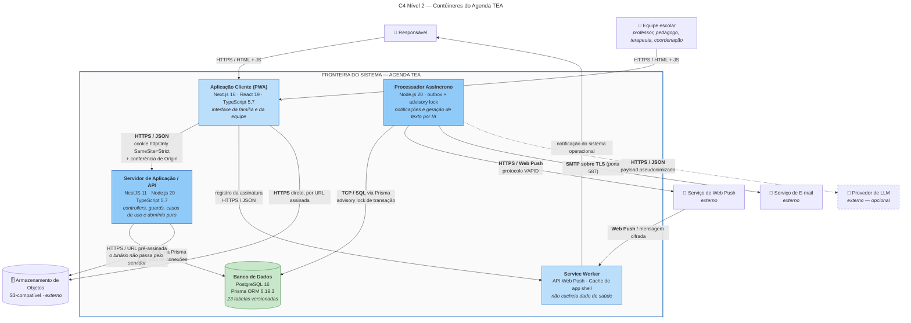
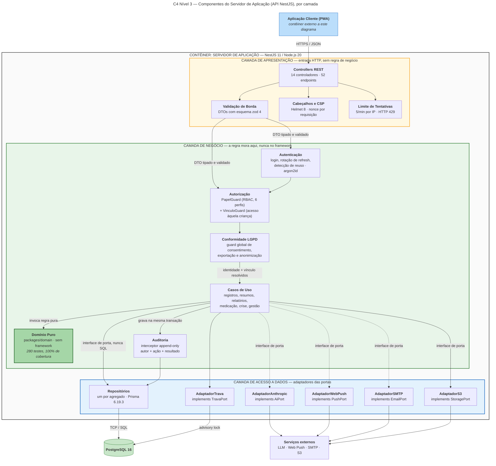

# Requisitos-e-Arquitetura-de-um-Sistema
# Agenda TEA — Levantamento de Requisitos e Arquitetura Cliente-Servidor

**Disciplina:** Projetos de Sistemas
**Instituição:** CIESA — Centro Universitário de Ensino Superior do Amazonas
**Curso:** Análise e Desenvolvimento de Sistemas
**Aluno:** Carlos Cândido · 25000656@estudante.ciesa.br
**Modalidade:** trabalho individual
**Data:** 04 de novembro de 2026

---

## Nota sobre o objeto do trabalho

O enunciado admite um negócio fictício situado em Manaus. Este trabalho usa, em lugar disso, um
**negócio real e em desenvolvimento**: o **Agenda TEA**, cuja comunidade parceira é o **Centro de
Educação Especial Maria das Graças, em Manaus** (90 alunos e 19 profissionais). Todos os requisitos,
decisões e tecnologias descritos aqui foram extraídos do próprio repositório do projeto
(`docs/PROBLEMA.md`, `docs/REQUISITOS.md`, `docs/ARQUITETURA.md`, `docs/SEGURANCA.md` e os
`package.json` das aplicações), e não de suposição de produto. Onde o modelo do enunciado pede um
elemento que o sistema real não possui — o módulo de Pagamentos do Nível 3 —, a ausência está
declarada e justificada na seção 2.1.3, em vez de preenchida com ficção.

---

## Identificação do negócio

| Item | Definição |
| --- | --- |
| **Nome do negócio/sistema** | **Agenda TEA** |
| **Natureza** | SaaS B2B por assinatura, com escopo de dados isolado por unidade escolar (*multi-tenant*) |
| **Cliente pagante** | A instituição (escola ou centro de educação especial), não a família |
| **Praça inicial** | Manaus (AM) — comunidade parceira: Centro de Educação Especial Maria das Graças |

### Proposta de valor

Substituir a agenda de papel da educação especial por um **registro diário estruturado, datado,
atribuído a um autor identificado e auditável**, que (a) reproduz fielmente o formulário de papel
que a escola já usa, para não criar trabalho duplicado; (b) acrescenta o que o papel não consegue
fazer — confirmação real de administração de medicação, registro estruturado de crise, confirmação
de leitura individual por responsável e alerta que persiste até a confirmação; e (c) nasce em
conformidade com o Art. 14 da Lei nº 13.709/2018 (LGPD), tratando dado de saúde de criança sob o
regime mais exigente da lei. O diferencial declarado é **declarar a lacuna**: o sistema informa
explicitamente o que *não* foi registrado, em vez de omitir.

### A dor local que o sistema resolve

Na agenda de papel, *"não comeu"* e *"ninguém anotou"* produzem exatamente o mesmo resultado visível
para a família: um campo em branco. Entre **25% e 30%** das crianças com TEA são não verbais ou têm
fala minimamente funcional — para elas, o registro do adulto da escola é a **única versão existente
do dia**, porque a família não pode perguntar ao filho como foi. Quando o caderno volta incompleto,
ilegível, esquecido na escola ou molhado na mochila — risco concreto no clima de Manaus —, decisões 
de cuidado (ajuste de rotina, ida ao neuropediatra, mudança de medicação) passam a ser tomadas por adivinhação. 
Para a instituição de Manaus, acumula-se uma segunda dor: ela não tem **prova** de que a informação crítica chegou à
família, porque a rubrica no caderno nunca demonstrou leitura efetiva. E não há, nesse perfil de
instituição, equipe de TI para operar software complexo — o que torna o custo de adoção, e não a
funcionalidade, o verdadeiro gargalo.

### O vazio de mercado ocupado

Plataformas de comunicação escolar têm boa usabilidade, mas não modelam medicação, crise ou
evacuação. Sistemas clínicos têm rigor, mas nenhum professor os opera em dois minutos no fim do
expediente, com uma criança em cada mão. O Agenda TEA ocupa a interseção: **rigor clínico na mão de
quem tem dois minutos**.

---

# 📌 PARTE 1 — LEVANTAMENTO DE REQUISITOS

## 1.1 Descrição do sistema

O **Agenda TEA** é um sistema de agenda digital integrada, vendido por assinatura a escolas e
centros de educação especial de Manaus, que substitui a agenda de papel usada como único canal
diário de comunicação entre a instituição e a família de crianças com Transtorno do Espectro Autista
(TEA), transformando o registro manuscrito em um registro estruturado, datado, atribuído a um autor
identificado e auditável, com confirmação de administração de medicação, registro estruturado de
crise e confirmação de leitura por responsável. O sistema é operado por **seis tipos de usuários**:
o **responsável** (pai, mãe ou tutor legal, que consome o registro e confirma a leitura), o
**professor** (docente da turma, que produz o registro diário no fim do expediente), o **pedagogo**
(apoio pedagógico, que consulta padrões e orienta a equipe), o **terapeuta** (terapeuta ocupacional,
fonoaudiólogo ou psicólogo vinculado à instituição, que registra a sessão do dia), a **coordenação**
(gestão da unidade, que cadastra turmas, crianças e contas, e precisa de visão agregada e de prova
de que a comunicação aconteceu) e o **administrador** (responsável técnico pela plataforma, que
gerencia contas, vínculos e os pedidos de exportação e exclusão de dados do titular, sem produzir
conteúdo clínico). O neuropediatra e a demais equipe de saúde **não são usuários do sistema**:
recebem da família o relatório consolidado exportado.

## 1.2 Requisitos Funcionais (RF)

| # | Requisito funcional |
| --- | --- |
| **RF01** | O sistema deve permitir que **o usuário** autentique-se com e-mail e senha e receba apenas as permissões do seu perfil e dos seus vínculos. |
| **RF02** | O sistema deve permitir que **o professor** registre, em um único formulário, todos os campos da agenda diária de uma criança da sua turma — entrada, saída, estado geral, alimentação, água, sono, evacuação, febre, terapias e anotações livres. |
| **RF03** | O sistema deve permitir que **o professor** registre uma crise informando horário, gatilho percebido, intensidade, duração e a estratégia que acalmou a criança. |
| **RF04** | O sistema deve permitir que **o professor** confirme a administração de uma dose prevista de medicação, informando o horário e o responsável pela administração. |
| **RF05** | O sistema deve permitir que **o professor** justifique, com motivo obrigatório, a não administração de uma dose prevista de medicação. |
| **RF06** | O sistema deve permitir que **o professor** corrija um registro de sua própria autoria, com justificativa obrigatória após a janela de correção direta. |
| **RF07** | O sistema deve permitir que **o terapeuta** registre a sessão de terapia realizada no dia com a criança em atendimento. 
| **RF08** | O sistema deve permitir que **o responsável** aceite o termo de consentimento de tratamento de dados antes de qualquer visualização de dado da criança. |
| **RF09** | O sistema deve permitir que **o responsável** visualize o resumo do dia da criança vinculada, incluindo a lista explícita dos campos que não foram registrados. |
| **RF10** | O sistema deve permitir que **o responsável** confirme a leitura do resumo diário, gerando um registro datado e atribuído que substitui a assinatura no caderno. |
| **RF11** | O sistema deve permitir que **o responsável** consulte a linha do tempo e o histórico de registros da criança por período. |
| **RF12** | O sistema deve permitir que **o responsável** exporte o relatório consolidado da semana para levar à equipe de saúde. |
| **RF13** | O sistema deve permitir que **o responsável** solicite a exportação e a exclusão dos dados dos quais é titular ou representante legal. |
| **RF14** | O sistema deve permitir que **o pedagogo** aprove ou rejeite o texto gerado por inteligência artificial antes do envio à família. |
| **RF15** | O sistema deve permitir que **a coordenação** cadastre turmas, crianças, contas e vínculos da própria unidade escolar. |
| **RF16** | O sistema deve permitir que **a coordenação** importe turmas, crianças e responsáveis em lote a partir de uma planilha CSV, com pré-visualização antes da gravação. |
| **RF17** | O sistema deve permitir que **a coordenação** envie convite por e-mail com token de uso único, para que o convidado defina a própria senha. |
| **RF18** | O sistema deve permitir que **a coordenação** consulte o log de auditoria das ações realizadas na sua unidade. |
| **RF19** | O sistema deve permitir que **o administrador** gerencie contas e vínculos e atenda aos pedidos de exportação e exclusão de dados do titular. |
| **RF20** | O sistema deve permitir que **o responsável** receba notificação em tempo real de evento crítico — medicação administrada ou crise severa — no seu próprio aparelho. |

> **Conformidade com o mínimo exigido:** 20 requisitos funcionais, todos no formato *"O sistema deve
> permitir que [usuário] [ação]"*, distribuídos entre os seis perfis descritos em 1.1.

## 1.3 Requisitos Não Funcionais (RNF)

Todos os RNF abaixo são **mensuráveis**: cada um declara limite numérico, percentual, prazo ou norma
técnica verificável. Nenhum usa formulação vaga.

| # | Categoria | Requisito não funcional mensurável |
| --- | --- | --- |
| **RNF01** | **Desempenho** | No percentil 95, salvar um registro deve concluir em **menos de 500 ms**; carregar o resumo do dia, em **menos de 2 s em rede 4G**; consultar o histórico de 30 dias, em **menos de 1 s**. |
| **RNF02** | **Usabilidade** | O preenchimento completo da agenda diária de uma criança deve ser concluído em **no máximo 2 minutos**, operável **com uma mão**, e obter nota **SUS ≥ 75** em teste com no mínimo 5 profissionais da instituição parceira. |
| **RNF03** | **Acessibilidade** | A interface deve atender à **WCAG 2.1 nível AA**: contraste mínimo de **4,5:1** em texto normal, alvos de toque de no mínimo **44 × 44 px**, navegação completa por teclado e **0 violação de severidade crítica** reportada pelo axe-core na integração contínua. |
| **RNF04** | **Segurança** | Senhas armazenadas com **argon2id**; tráfego exclusivamente sobre **TLS 1.2 ou superior**; *access token* com validade de **15 minutos** e *refresh token* de **7 dias** com rotação a cada uso; no máximo **5 tentativas de autenticação por minuto por endereço IP**, respondidas com **HTTP 429**; os **10 itens do OWASP Top 10** documentados item a item com a mitigação correspondente. |
| **RNF05** | **Disponibilidade** | Disponibilidade mínima de **99% na janela escolar de 07h às 19h em dias úteis** — o que admite no máximo **7,2 minutos** de indisponibilidade por dia útil. A indisponibilidade de **100%** do provedor de inteligência artificial **não** pode impedir a entrega do resumo diário estruturado. |
| **RNF06** | **Compatibilidade** | O cliente deve funcionar como **PWA**, sem instalação por loja de aplicativos, nas **duas últimas versões maiores** de Chrome, Safari e Edge, em **Android 10+** e **iOS 16+**, em telas a partir de **320 px** de largura. |
| **RNF07** | **Conformidade e auditabilidade** | **100%** das ações críticas devem gravar autor, ação e resultado na **mesma transação atômica** do dado que as originou; retenção de dados declarada de **5 anos**, com anonimização ao fim do prazo; **0** ocorrência de dado pessoal identificável direto transmitido a provedor externo de modelo de linguagem. |
| **RNF08** | **Manutenibilidade** | Cobertura de testes de **no mínimo 70%** no pacote de domínio; **0 erro** de análise estática e de checagem de tipos no repositório; a suíte completa (**714 testes** na medição de outubro de 2026) executada como portão obrigatório a cada alteração. |
| **RNF09** | **Escalabilidade** | A arquitetura deve suportar **no mínimo 50 unidades escolares** e **4.500 crianças** sem alteração estrutural, com processos **sem estado em memória** e isolamento de dados resolvido no servidor por unidade. |

> **Cobertura de categorias exigida:** o enunciado pede no mínimo 4 das 5 categorias listadas; este
> documento cobre **todas as 5** — desempenho (RNF01), usabilidade/acessibilidade (RNF02 e RNF03),
> segurança (RNF04), disponibilidade (RNF05) e compatibilidade (RNF06) — e acrescenta conformidade
> (RNF07), manutenibilidade (RNF08) e escalabilidade (RNF09).

## 1.4 Regras de Negócio (RN)

As regras abaixo **existem independentemente do sistema**: todas vigoram hoje, na agenda de papel, na
rotina da instituição ou na legislação brasileira. O software apenas as **passa a impor**; nenhuma
delas é uma funcionalidade.

| # | Regra de negócio | Por que existe sem o sistema |
| --- | --- | --- |
| **RN01** | Medicação só pode ser administrada a uma criança na instituição se houver **prescrição médica vigente** e **autorização escrita do responsável legal**, com dose e horário definidos pelo prescritor — nunca pela escola. | Decorre da responsabilidade civil e sanitária da instituição; hoje se materializa no envelope de receita que a família entrega na secretaria. |
| **RN02** | O tratamento de dados de saúde de uma criança exige **consentimento específico e destacado de ao menos um dos responsáveis legais** e deve ocorrer sempre no melhor interesse da criança. | Art. 14 da Lei nº 13.709/2018 (LGPD). Vigora com ou sem software; hoje é o termo assinado na matrícula. |
| **RN03** | Uma criança pode ter **mais de um responsável legal**, e todos têm **igual direito** de ser informados sobre o dia dela — o direito de um não se extingue porque o outro foi informado. | Decorre do poder familiar (Código Civil) e é rotina em famílias com guarda compartilhada; hoje gera o conflito do caderno que só vai para a casa de um dos pais. |
| **RN04** | Somente o **profissional vinculado** à criança relata o dia dela: quem não a atendeu não produz registro sobre ela. | É a responsabilidade profissional pelo que se afirma — o professor assina o que viu. Vigora na agenda de papel, onde quem preenche é quem esteve com a turma. |
| **RN05** | Um registro de cuidado **não é apagado**: a correção posterior preserva o valor anterior e exige justificativa de quem corrigiu. | Prática de prontuário e de registro escolar — no caderno, corrige-se riscando e rubricando ao lado, nunca apagando. |
| **RN06** | A função **administrativa** da instituição (secretaria, TI) **não produz conteúdo clínico ou pedagógico** sobre a criança; isso cabe ao profissional habilitado que a atendeu. | Separação de atribuições profissionais da instituição; a secretária não escreve na agenda da criança hoje. |
| **RN07** | Evento com **risco à integridade física** da criança — crise severa, febre, uso de medicação de resgate — deve ser comunicado ao responsável **no mesmo dia**, não no boletim do mês. | Dever de cuidado e de informação da instituição; hoje se cumpre com uma ligação telefônica. |
| **RN08** | O registro do acompanhamento da criança deve ser **guardado por 5 anos**, prazo declarado no consentimento, para fins pedagógicos e médicos. | Prazo de guarda documental já praticado pela instituição para a documentação escolar e para a continuidade do cuidado em saúde. |

## 1.5 Tabela única de requisitos

| Código | Tipo | Descrição | Prioridade |
| --- | --- | --- | --- |
| RF01 | Funcional | O sistema deve permitir que o usuário autentique-se com e-mail e senha e receba apenas as permissões do seu perfil e dos seus vínculos. | Alta |
| RF02 | Funcional | O sistema deve permitir que o professor registre, em um único formulário, todos os campos da agenda diária de uma criança da sua turma. | Alta |
| RF03 | Funcional | O sistema deve permitir que o professor registre uma crise com horário, gatilho, intensidade, duração e estratégia de contenção. | Alta |
| RF04 | Funcional | O sistema deve permitir que o professor confirme a administração de uma dose prevista de medicação, com horário e responsável. | Alta |
| RF05 | Funcional | O sistema deve permitir que o professor justifique, com motivo obrigatório, a não administração de uma dose prevista. | Alta |
| RF06 | Funcional | O sistema deve permitir que o professor corrija registro de sua própria autoria, com justificativa após a janela de correção direta. | Média |
| RF07 | Funcional | O sistema deve permitir que o terapeuta registre a sessão de terapia realizada no dia. | Média |
| RF08 | Funcional | O sistema deve permitir que o responsável aceite o termo de consentimento antes de qualquer visualização de dado da criança. | Alta |
| RF09 | Funcional | O sistema deve permitir que o responsável visualize o resumo do dia, incluindo a lista do que não foi registrado. | Alta |
| RF10 | Funcional | O sistema deve permitir que o responsável confirme a leitura do resumo diário, com registro datado e atribuído. | Alta |
| RF11 | Funcional | O sistema deve permitir que o responsável consulte a linha do tempo e o histórico por período. | Média |
| RF12 | Funcional | O sistema deve permitir que o responsável exporte o relatório consolidado da semana. | Média |
| RF13 | Funcional | O sistema deve permitir que o responsável solicite exportação e exclusão dos dados de que é titular ou representante. | Alta |
| RF14 | Funcional | O sistema deve permitir que o pedagogo aprove ou rejeite o texto gerado por IA antes do envio à família. | Média |
| RF15 | Funcional | O sistema deve permitir que a coordenação cadastre turmas, crianças, contas e vínculos da própria unidade. | Alta |
| RF16 | Funcional | O sistema deve permitir que a coordenação importe turmas, crianças e responsáveis em lote por planilha CSV, com pré-visualização. | Média |
| RF17 | Funcional | O sistema deve permitir que a coordenação envie convite por e-mail com token de uso único para definição da própria senha. | Alta |
| RF18 | Funcional | O sistema deve permitir que a coordenação consulte o log de auditoria da sua unidade. | Média |
| RF19 | Funcional | O sistema deve permitir que o administrador gerencie contas e vínculos e atenda pedidos de exportação e exclusão. | Alta |
| RF20 | Funcional | O sistema deve permitir que o responsável receba notificação em tempo real de medicação administrada ou crise severa. | Alta |
| RNF01 | Não funcional — Desempenho | p95 < 500 ms para salvar registro; < 2 s em 4G para o resumo do dia; < 1 s para histórico de 30 dias. | Alta |
| RNF02 | Não funcional — Usabilidade | Preenchimento da agenda em ≤ 2 minutos, operável com uma mão, nota SUS ≥ 75 com ao menos 5 profissionais. | Alta |
| RNF03 | Não funcional — Acessibilidade | WCAG 2.1 AA: contraste ≥ 4,5:1, alvos ≥ 44 × 44 px, navegação por teclado, 0 violação crítica no axe-core. | Alta |
| RNF04 | Não funcional — Segurança | argon2id; TLS 1.2+; token de 15 min e refresh de 7 dias com rotação; máx. 5 tentativas/min por IP com HTTP 429; OWASP Top 10 documentado item a item. | Alta |
| RNF05 | Não funcional — Disponibilidade | ≥ 99% entre 07h e 19h em dias úteis (≤ 7,2 min/dia útil); falha total da IA não impede o resumo estruturado. | Alta |
| RNF06 | Não funcional — Compatibilidade | PWA sem loja de aplicativos; duas últimas versões maiores de Chrome, Safari e Edge; Android 10+, iOS 16+; telas ≥ 320 px. | Alta |
| RNF07 | Não funcional — Conformidade | 100% das ações críticas auditadas na mesma transação; retenção de 5 anos com anonimização; 0 PII direta enviada a LLM externo. | Alta |
| RNF08 | Não funcional — Manutenibilidade | Cobertura ≥ 70% no domínio; 0 erro de lint e de tipos; 714 testes como portão obrigatório por alteração. | Média |
| RNF09 | Não funcional — Escalabilidade | ≥ 50 unidades escolares e 4.500 crianças sem alteração estrutural; processos sem estado; isolamento por unidade no servidor. | Média |
| RN01 | Regra de negócio | Medicação exige prescrição médica vigente e autorização escrita do responsável legal, com dose e horário definidos pelo prescritor. | Alta |
| RN02 | Regra de negócio | Tratamento de dado de saúde de criança exige consentimento específico e destacado de ao menos um responsável legal (LGPD, Art. 14). | Alta |
| RN03 | Regra de negócio | Uma criança pode ter vários responsáveis legais, e todos têm igual direito de ser informados. | Alta |
| RN04 | Regra de negócio | Somente o profissional vinculado à criança produz registro sobre ela. | Alta |
| RN05 | Regra de negócio | Registro de cuidado não é apagado; a correção preserva o valor anterior e exige justificativa. | Alta |
| RN06 | Regra de negócio | A função administrativa não produz conteúdo clínico ou pedagógico sobre a criança. | Média |
| RN07 | Regra de negócio | Evento com risco à integridade física deve ser comunicado ao responsável no mesmo dia. | Alta |
| RN08 | Regra de negócio | O registro do acompanhamento é guardado por 5 anos, prazo declarado no consentimento. | Média |

---

# 🏗️ PARTE 2 — DOCUMENTO DE ARQUITETURA CLIENTE-SERVIDOR

## 2.1 Diagramas C4

### 2.1.1 Nível 1 — Diagrama de Contexto

```mermaid
---
title: "C4 Nível 1 — Contexto do Sistema Agenda TEA"
---
flowchart TB
    resp["👤 Responsável<br/><i>pai, mãe ou tutor legal</i>"]
    prof["👤 Professor<br/><i>docente da turma</i>"]
    ped["👤 Pedagogo<br/><i>apoio pedagógico</i>"]
    ter["👤 Terapeuta<br/><i>TO, fono ou psicólogo da instituição</i>"]
    coord["👤 Coordenação<br/><i>gestão da unidade escolar</i>"]
    adm["👤 Administrador<br/><i>responsável técnico da plataforma</i>"]

    sistema["<b>AGENDA TEA</b><br/>Sistema de agenda digital integrada<br/>para acompanhamento de crianças com TEA"]

    email["📧 Serviço de E-mail (SMTP)<br/><i>sistema externo</i>"]
    push["🔔 Serviço de Web Push (VAPID)<br/><i>sistema externo</i>"]
    llm["🤖 Provedor de LLM<br/><i>sistema externo — opcional</i>"]
    s3["🗄️ Armazenamento de Objetos (S3)<br/><i>sistema externo</i>"]

    prof -->|"registro da agenda diária, crise<br/>e confirmação de dose"| sistema
    ter -->|"registro da sessão de terapia"| sistema
    ped -->|"aprovação do texto gerado por IA"| sistema
    coord -->|"turmas, crianças, contas,<br/>vínculos e planilha CSV"| sistema
    adm -->|"contas, vínculos e pedidos<br/>de exportação e exclusão"| sistema
    resp -->|"aceite do termo de consentimento<br/>e confirmação de leitura"| sistema

    sistema -->|"resumo do dia, lacunas declaradas,<br/>histórico e relatório da semana"| resp
    sistema -->|"lista de doses previstas<br/>e pendências do dia"| prof
    sistema -->|"padrões da turma e histórico"| ped
    sistema -->|"histórico para ajuste de conduta"| ter
    sistema -->|"visão agregada da unidade<br/>e log de auditoria"| coord

    sistema -->|"convite com token de uso único<br/>e lembrete de leitura pendente"| email
    sistema -->|"alerta de medicação administrada<br/>e de crise severa"| push
    sistema -->|"registros pseudonimizados<br/><b>sem nome, documento ou endereço</b>"| llm
    sistema -->|"foto do dia via URL assinada"| s3
    push -->|"entrega do alerta ao aparelho"| resp
    email -->|"mensagem de convite e de lembrete"| resp

    style sistema fill:#1565c0,stroke:#0d47a1,color:#fff
    style resp fill:#e8eaf6,stroke:#3f51b5
    style prof fill:#e8eaf6,stroke:#3f51b5
    style ped fill:#e8eaf6,stroke:#3f51b5
    style ter fill:#e8eaf6,stroke:#3f51b5
    style coord fill:#e8eaf6,stroke:#3f51b5
    style adm fill:#e8eaf6,stroke:#3f51b5
    style email fill:#eceff1,stroke:#607d8b
    style push fill:#eceff1,stroke:#607d8b
    style llm fill:#eceff1,stroke:#607d8b,stroke-dasharray: 5 5
    style s3 fill:#eceff1,stroke:#607d8b
```



**Legenda do Nível 1**

| Elemento | Significado |
| --- | --- |
| 🔵 Caixa azul central | O sistema em projeto (Agenda TEA), tratado como caixa-preta neste nível |
| 👤 Caixa lilás | Pessoa (ator humano) — os seis perfis de usuário definidos no RF01 e na seção 1.1 |
| ⬜ Caixa cinza | Sistema externo, fora do escopo de desenvolvimento e mantido por terceiros |
| → Seta contínua | Fluxo de informação, rotulado com **o dado que trafega** |
| ╌╌ Contorno tracejado (LLM) | Dependência **opcional**: sem credencial do provedor, o resumo estruturado continua completo (RNF05) |
| Fora do diagrama | O **neuropediatra** não é usuário: recebe da família o relatório exportado no RF12 |

**Rastreabilidade:** RF01, RF08–RF13, RF20 (Responsável) · RF02–RF06 (Professor) · RF07 (Terapeuta)
· RF14 (Pedagogo) · RF15–RF18 (Coordenação) · RF19 (Administrador) · RNF07 (seta pseudonimizada para
o LLM) · RN02 (aceite do termo antes de qualquer visualização) · RN07 (seta de alerta via Web Push).

---

### 2.1.2 Nível 2 — Diagrama de Contêineres



**Legenda do Nível 2**

| Elemento | Significado |
| --- | --- |
| 🟦 Azul claro | Contêiner de **apresentação** executado no dispositivo do usuário |
| 🟦 Azul escuro | Contêiner de **execução no servidor** |
| 🟩 Verde (cilindro) | Contêiner de **persistência** |
| Retângulo pontilhado | Fronteira do sistema: o que está dentro é desenvolvido e implantado pelo projeto |
| → Seta rotulada | Chamada entre contêineres, rotulada com o **protocolo** e o formato de dados |
| ╌╌ Seta tracejada | Chamada opcional e fora do caminho crítico da requisição |

**Decisões visíveis neste nível**

1. **O cliente nunca fala com o banco, o storage ou o LLM.** Todo acesso passa pela API, que é o
   único lugar onde o vínculo é verificado e a auditoria é escrita — exigência direta de RN04 e RNF07.
2. **O Processador Assíncrono existe por causa de RNF01 e RNF05:** nenhuma requisição HTTP espera por
   provedor externo, e um processo que cai não perde evento de notificação (padrão *outbox*).
3. **O binário da foto não atravessa o servidor:** a API emite URL pré-assinada e o PWA fala direto
   com o storage, o que mantém a latência de RNF01 independente do tamanho do arquivo.
4. **O Service Worker não cacheia dado de saúde** — um aparelho perdido no transporte público de
   Manaus não pode virar vazamento (RNF04, RNF07).

---

### 2.1.3 Nível 3 — Diagrama de Componentes (interior do Servidor de Aplicação)



**Legenda do Nível 3**

| Elemento | Significado |
| --- | --- |
| 🟨 Bloco amarelo | **Camada de Apresentação** — traduz HTTP em objeto validado; não contém regra de negócio |
| 🟩 Bloco verde | **Camada de Negócio** — casos de uso, guards e o domínio puro; é onde a regra vive |
| 🟦 Bloco azul | **Camada de Acesso a Dados** — adaptadores que implementam as portas declaradas no negócio |
| 🟩 Verde escuro (`Domínio Puro`) | Núcleo sem nenhuma dependência de framework, banco ou rede |
| → Seta contínua | Dependência obrigatória, sempre **de fora para dentro** (regra de dependência da Clean Architecture) |
| ╌╌ Seta tracejada | Dependência opcional: sem credencial, a fábrica entrega a versão desligada da porta |

**Ordem de execução de toda requisição autenticada**
`CSP com nonce → sessão em cookie httpOnly → papel (RBAC) → vínculo com aquela criança → validação de esquema na borda → caso de uso no domínio puro → auditoria na mesma transação`


---

## 2.2 Matriz de rastreabilidade requisito → arquitetura

| Requisito | Contêiner (Nível 2) | Componente (Nível 3) | ADR relacionado |
| --- | --- | --- | --- |
| RF01, RNF04 | API | Autenticação, Limite de Tentativas | ADR-002 |
| RF02–RF07 | PWA, API, Banco | Controllers, Casos de Uso, Domínio Puro, Repositórios | ADR-001 |
| RF08, RF13, RNF07 | API, Banco | Conformidade LGPD, Auditoria | ADR-001 |
| RF09–RF12 | PWA, API, Banco | Casos de Uso (resumos, relatórios), Repositórios | ADR-001 |
| RF14 | PWA, API, Processador Assíncrono | Casos de Uso, AdaptadorAnthropic | ADR-003 |
| RF15–RF19 | PWA, API | Autorização, Casos de Uso (gestão) | ADR-002 |
| RF20, RN07 | Processador Assíncrono, Service Worker | AdaptadorWebPush, AdaptadorTrava | ADR-003 |
| RNF01 | API, Processador Assíncrono | separação síncrono/assíncrono, URL assinada | ADR-003 |
| RNF05 | Todos | resumo estruturado independente do LLM | ADR-003 |
| RNF09, RN04 | API, Banco | Autorização (escopo de unidade), Repositórios | ADR-001, ADR-003 |
| RN01, RN05 | Banco | `plano_medicacao` separado de `registro_medicacao`; log append-only | ADR-001 |
| RN02, RN08 | Banco | termo versionado imutável com gatilho no banco; retenção de 5 anos | ADR-001 |

---

## 2.3 Registros de Decisão Arquitetural (ADRs)

### ADR-001 Adoção de banco de dados relacional PostgreSQL em lugar de banco não-relacional

```markdown
# ADR-001 Adoção de banco de dados relacional PostgreSQL em lugar de banco não-relacional
Status: Aceita
Data: 2026-08-25

## Contexto

As seguintes exigências determinam esta decisão:

- **RN01** — medicação exige prescrição vigente e autorização do responsável: a *dose prevista*
  (prescrição transcrita) e o *fato administrado* são entidades distintas que precisam ser
  relacionadas sem permitir estado ambíguo.
- **RN03** — uma criança pode ter N responsáveis legais, todos com igual direito de acesso: é uma
  relação muitos-para-muitos com integridade obrigatória, pois um vínculo perdido é um direito legal
  violado.
- **RN05** — registro de cuidado não é apagado; a correção preserva o valor anterior.
- **RNF07** — 100% das ações críticas devem gravar autor, ação e resultado **na mesma transação
  atômica** do dado que as originou.
- **RF16** — a importação em lote de uma planilha CSV da escola deve ser atômica: ou entra tudo, ou
  não entra nada.

O ponto decisivo é RNF07 combinado com RF16: sem transação ACID que abranja o dado e sua trilha de
auditoria, existe uma janela em que o registro de saúde está gravado e a prova de quem o gravou não
está — exatamente o estado que o sistema foi construído para eliminar.

## Alternativas consideradas

### Alternativa A: PostgreSQL (relacional) com Prisma ORM
- A favor: transações ACID multi-tabela atendem RNF07 e RF16 diretamente; chaves estrangeiras
  tornam o vínculo de RN03 uma garantia do banco e não do código de aplicação; *migrations*
  versionadas e revisáveis em *pull request*; restrições `CHECK` e gatilhos permitem escrever RN02 e
  RN05 no próprio banco (o termo de consentimento publicado é imutável por gatilho); *advisory lock*
  de transação resolve a produção de alertas entre réplicas sem tabela extra; tipos derivados do
  esquema evitam divergência entre banco e aplicação.
- Contra: esquema rígido — toda mudança de campo da agenda exige *migration*; escala horizontal de
  escrita é mais trabalhosa que em bancos documentais; exige conhecimento de modelagem relacional
  para manutenção.

### Alternativa B: MongoDB (documental, não-relacional)
- A favor: o registro diário é naturalmente um documento, e a agenda de papel tem campos que variam
  entre instituições — o esquema flexível acomodaria isso sem *migration*; leitura do dia inteiro em
  uma única consulta, sem junções, favorecendo RNF01; escala horizontal de escrita mais simples.
- Contra: transação multi-documento exige *replica set* e continua mais frágil e custosa do que uma
  transação relacional, o que coloca RNF07 em risco permanente; a integridade do vínculo de RN03
  passaria a ser responsabilidade do código de aplicação, sem rede de segurança do banco; RN05
  dependeria de disciplina de escrita, já que nada impede um `update` destrutivo; RF16 atômico
  exigiria compensação manual em caso de falha parcial.

## Decisão

Escolhemos a **Alternativa A (PostgreSQL com Prisma ORM)**, porque **RNF07 exige que autor, ação e
resultado sejam gravados na mesma transação atômica do dado que os originou, e RN05 proíbe a
sobrescrita do valor anterior** — garantias que, em um banco relacional, são propriedades do
mecanismo de armazenamento, e não convenções que o código precisa lembrar de respeitar a cada
*endpoint*. Em um sistema cujo propósito declarado é ser prova de que a informação existiu e chegou,
a trilha de auditoria não pode ser *best effort*. A integridade referencial de RN03 reforça a
escolha: o vínculo entre criança e responsável é um direito legal, e colocá-lo sob chave estrangeira
significa que nenhum erro de aplicação pode silenciosamente apagá-lo.

## Consequências

- Positivas:
  - RNF07 e RF16 são atendidos por transação nativa, sem código de compensação.
  - RN02, RN03 e RN05 passam a ser aplicados pelo banco (gatilho de imutabilidade do termo, chave
    estrangeira do vínculo, log *append-only*), não apenas pela aplicação.
  - As 23 tabelas têm *migrations* versionadas e revisáveis, o que torna a evolução do esquema
    auditável como o próprio dado.
  - O *advisory lock* do PostgreSQL resolve a exclusão mútua na produção de alertas sem introduzir
    outra peça de infraestrutura.
- Negativas:
  - **Toda alteração nos campos da agenda exige *migration* e novo *deploy*.** Como o formulário de
    papel varia entre instituições, cada nova escola cliente pode demandar trabalho de esquema —
    atrito direto contra o modelo de negócio de "uma escola nova entra em minutos" e um custo real
    de escala comercial.
  - A escala horizontal de escrita é mais trabalhosa; ao atingir o limite de RNF09, a saída será
    réplica de leitura e particionamento, não adição de nós.
  - A dependência fixada em Prisma 6.19.3 (e não em `latest`) é dívida técnica registrada: a
    migração para a linha 7.x fica pendente até que CLI e cliente estejam realinhados.
```

---

### ADR-002 Sessão do navegador em cookies `httpOnly` com JWT curto e refresh rotativo

```markdown
# ADR-002 Sessão do navegador em cookies httpOnly com JWT curto e refresh rotativo
Status: Aceita
Data: 2026-09-10

## Contexto

As seguintes exigências determinam esta decisão:

- **RNF04** — senhas em argon2id, *access token* de 15 minutos, *refresh token* de 7 dias com
  rotação a cada uso, e os 10 itens do OWASP Top 10 mitigados item a item. Isso inclui A03
  (injeção/XSS) e A07 (falhas de identificação e autenticação).
- **RNF07** — nenhum dado pessoal identificável direto deve circular fora do necessário; o *payload*
  da sessão não pode conter dado sensível.
- **RNF09** — processos sem estado em memória, para permitir múltiplas réplicas.
- **RN04 e RN06** — a decisão de quem pode registrar sobre qual criança, e de quem não produz
  conteúdo clínico, é regra da instituição: precisa ser resolvida no servidor, a partir do vínculo
  persistido, nunca a partir de papel informado pelo cliente.

O problema concreto: o público usuário acessa o PWA de aparelhos pessoais, muitas vezes
compartilhados na família, em uma instituição sem equipe de TI. Uma única falha de XSS que exponha a
sessão daria acesso ao histórico de saúde de uma criança.

## Alternativas consideradas

### Alternativa A: Sessão em servidor com identificador em cookie (sessão clássica)
- A favor: revogação imediata e central — encerrar a sessão é apagar uma linha; nada de valor
  trafega no cookie; modelo mental simples e bem conhecido.
- Contra: viola RNF09, pois exige estado compartilhado entre réplicas (armazenamento de sessão
  dedicado), acrescentando uma peça de infraestrutura a operar e monitorar; cada requisição paga uma
  consulta ao armazenamento de sessão, pressionando a meta de p95 < 500 ms de RNF01.

### Alternativa B: JWT guardado em `sessionStorage` e enviado em cabeçalho `Authorization`
- A favor: imune a CSRF por construção, já que o navegador não anexa o cabeçalho sozinho; servidor
  totalmente sem estado, atendendo RNF09; implementação direta e portável para clientes que não são
  navegador.
- Contra: **qualquer XSS lê o token e leva a sessão embora** — risco inaceitável diante de RNF04 e
  do dado em jogo; a revogação antes da expiração é difícil; obriga o código do cliente a manipular
  o segredo, ampliando a superfície de erro.

### Alternativa C: Cookies `httpOnly` com JWT curto, refresh rotativo e conferência de `Origin`
- A favor: JavaScript não alcança o token, de modo que um XSS não rouba a sessão; `SameSite=Strict`
  mais a verificação de `Origin` contra a lista branca cobre CSRF sem estado adicional no servidor;
  servidor sem estado atende RNF09; a rotação do *refresh* permite **detectar reuso** — apresentar um
  token já substituído revoga a cadeia inteira e gera auditoria, que é a assinatura clássica de token
  roubado; o *payload* carrega apenas `sub`, `papel` e `jti`, sem dado sensível (RNF07).
- Contra: PWA e API precisam estar no mesmo site e em HTTPS, o que restringe topologias de
  implantação; a revogação do *access token* não é instantânea — há até 15 minutos de janela; exige
  um segundo modo de autenticação para clientes que não são navegador.

## Decisão

Escolhemos a **Alternativa C (cookies `httpOnly` com JWT curto, refresh rotativo e conferência de
`Origin`)**, porque **RNF04 exige a mitigação documentada de A03 e A07 do OWASP Top 10 sobre dado de
saúde de criança, e a Alternativa B falha justamente ali: nela, um único XSS converte-se em acesso
integral ao histórico da criança**. A Alternativa A protegeria igualmente, mas ao custo de estado
compartilhado que RNF09 proíbe e de uma consulta por requisição que pressiona RNF01. A rotação com
detecção de reuso é o que fecha a exigência de A07: o sistema não apenas resiste ao roubo de token,
ele o **percebe** e derruba a cadeia, gravando o evento na trilha de auditoria de RNF07.
Complementarmente, a autorização continua sendo resolvida no servidor a partir do vínculo
persistido, de modo que o cookie prova *quem* é o usuário, mas nunca *o que* ele pode fazer —
atendendo RN04 e RN06.

## Consequências

- Positivas:
  - XSS deixa de ser caminho para roubo de sessão: o token não é alcançável por JavaScript.
  - CSRF é coberto sem token sincronizado nem estado extra no servidor.
  - O reuso de *refresh token* é detectado e revoga a cadeia completa, com registro em auditoria.
  - O servidor permanece sem estado, compatível com múltiplas réplicas (RNF09).
  - O *payload* da sessão não contém dado sensível, reduzindo o impacto de um vazamento de token.
- Negativas:
  - **A revogação não é imediata: um *access token* já emitido continua válido por até 15 minutos
    após o encerramento da sessão.** Em um incidente real — aparelho perdido no transporte público —
    existe uma janela de até 15 minutos de acesso ao dado da criança, e esse é um risco aceito
    conscientemente em troca de não manter estado de sessão no servidor.
  - PWA e API passam a ter de estar no mesmo site, sob HTTPS, o que elimina topologias de
    implantação em domínios separados e torna a configuração de CORS e de proxy reverso parte do
    requisito de segurança, não apenas de infraestrutura.
  - Mantém-se um segundo modo de autenticação (token no corpo) para clientes que não são navegador e
    para a suíte de testes, ou seja, dois caminhos de sessão a manter e testar.
  - Os contadores de limite de tentativas vivem na memória do processo: com mais de uma réplica, o
    limite efetivo de 5 tentativas por minuto de RNF04 multiplica-se pelo número de réplicas.
```

---

### ADR-003 Implantação em nuvem gerenciada e containerizada, em lugar de servidor próprio na escola

```markdown
# ADR-003 Implantação em nuvem gerenciada e containerizada, em lugar de servidor próprio na escola
Status: Aceita
Data: 2026-10-05

## Contexto

As seguintes exigências determinam esta decisão:

- **RNF05** — disponibilidade de no mínimo 99% na janela escolar de 07h às 19h em dias úteis, o que
  admite no máximo 7,2 minutos de indisponibilidade por dia útil.
- **RNF09** — suportar no mínimo 50 unidades escolares e 4.500 crianças sem alteração estrutural,
  com processos sem estado e isolamento de dados por unidade resolvido no servidor.
- **RNF01** — metas de latência no percentil 95, que dependem de rede e de capacidade de banco.
- **RNF04 e RNF07** — TLS 1.2+ obrigatório, criptografia em repouso, retenção de 5 anos com
  anonimização ao fim do prazo e trilha de auditoria preservada.
- **RNF06** — PWA sem loja de aplicativos, acessível por qualquer navegador.
- Restrição de contexto: a instituição parceira em Manaus tem 19 profissionais e **nenhuma equipe de
  TI**. O modelo de negócio é SaaS B2B por assinatura, com custo marginal baixo por nova escola.

O ponto decisivo é a combinação de RNF05 com a realidade local: Manaus tem interrupções de energia e
de enlace de internet com frequência não desprezível, e o perfil de cliente não dispõe de gerador,
nobreak dimensionado, enlace redundante ou pessoa de plantão. Um servidor dentro da escola colocaria
a meta de 99% sob variáveis que o projeto não controla e que a instituição não tem como administrar.

## Alternativas consideradas

### Alternativa A: Servidor próprio (*on-premise*) em cada escola cliente
- A favor: o dado de saúde da criança nunca sai fisicamente da instituição, o que é um argumento
  forte de conformidade e de confiança para a família; funciona na rede local mesmo com a internet
  da escola fora do ar; custo previsível e sem recorrência em moeda estrangeira.
- Contra: inviabiliza RNF05, pois a disponibilidade passaria a depender da energia, do enlace e do
  hardware de cada escola, sem redundância nem plantão; inviabiliza RNF09, já que cada nova escola
  exigiria aquisição, instalação e manutenção de equipamento, destruindo o custo marginal baixo do
  modelo SaaS; as responsabilidades de RNF04 e RNF07 (atualização de segurança, cópia de segurança,
  criptografia em repouso, retenção de 5 anos) recairiam sobre uma instituição sem equipe de TI, o
  que na prática significa que não seriam cumpridas; 50 escolas significariam 50 ambientes de
  produção distintos a diagnosticar.

### Alternativa B: Nuvem gerenciada com aplicação containerizada e banco gerenciado
- A favor: atende RNF05 com infraestrutura redundante de energia e de rede, fora do alcance das
  intermitências locais; atende RNF09 porque uma nova escola é um registro de unidade no banco
  *multi-tenant*, sem hardware a adquirir nem ambiente a provisionar; cópia de segurança,
  criptografia em repouso e TLS gerenciados atendem RNF04 e RNF07 sem exigir equipe de TI na escola;
  imagens Docker *multi-stage* garantem que o ambiente de produção seja idêntico ao verificado em
  integração contínua; segredos externos à imagem; a escala vertical e a réplica de leitura são
  mudanças de configuração, não de arquitetura.
- Contra: cria dependência de fornecedor e custo recorrente proporcional ao uso; o dado de saúde
  passa a residir fora da instituição e, possivelmente, fora do país, o que exige cláusula
  contratual e transparência no termo de consentimento; a escola sem internet perde o acesso
  completamente, pois o PWA não cacheia dado de saúde por decisão de RNF04; a latência até Manaus
  depende da região de hospedagem escolhida.

## Decisão

Escolhemos a **Alternativa B (nuvem gerenciada com aplicação containerizada e banco gerenciado)**,
porque **RNF05 fixa 99% de disponibilidade na janela escolar e RNF09 exige 50 unidades sem alteração
estrutural — e a Alternativa A torna as duas metas impossíveis de sustentar no contexto real de
Manaus**, onde o cliente não dispõe de energia redundante, enlace redundante nem pessoa de plantão
para cumprir 7,2 minutos de indisponibilidade por dia útil. O argumento decisivo é de
responsabilidade: transferir a uma instituição de 19 profissionais sem equipe de TI os deveres de
atualização de segurança, cópia de segurança, criptografia em repouso e retenção de 5 anos exigidos
por RNF04 e RNF07 equivale a declarar esses requisitos no documento e não cumpri-los na prática. A
nuvem gerenciada mantém essas obrigações com quem tem competência técnica para honrá-las, e preserva
o custo marginal baixo por escola que o modelo de assinatura exige.

## Consequências

- Positivas:
  - RNF05 passa a depender de infraestrutura redundante, e não da rede elétrica do bairro.
  - Uma nova escola cliente é criada em minutos, por cadastro de unidade e importação CSV, sem
    hardware nem provisionamento (RNF09, RF16).
  - Cópia de segurança, criptografia em repouso, renovação de TLS e correções de segurança ficam sob
    responsabilidade de quem tem competência para executá-las (RNF04, RNF07).
  - A imagem containerizada *multi-stage* garante paridade entre o que a integração contínua
    verificou e o que roda em produção, sustentando RNF08.
  - Processos sem estado permitem acrescentar réplicas sem redesenhar a aplicação.
- Negativas:
  - **Sem internet, a escola perde o sistema por completo.** Como o Service Worker não cacheia dado
    de saúde (decisão de RNF04), uma queda de enlace durante a janela escolar deixa a equipe sem
    acesso ao plano de medicação do dia — e esse é precisamente o momento em que o dado é crítico. A
    mitigação prevista é o procedimento de contingência em papel para o plano de medicação, o que
    significa admitir que o papel não desaparece por inteiro.
  - Dependência de fornecedor e custo recorrente que cresce com o número de escolas, com exposição à
    variação cambial.
  - O dado de saúde de criança passa a residir fora da instituição, exigindo cláusula de
    transferência no contrato e declaração explícita no termo de consentimento de RN02 — o que
    aumenta o atrito da venda junto a famílias e gestores mais conservadores.
  - A latência até Manaus fica condicionada à região de hospedagem, e a meta de RNF01 precisa ser
    medida com clientes reais na cidade, não apenas em laboratório.
```

---

## 2.4 Síntese da arquitetura

| Dimensão | Definição adotada |
| --- | --- |
| **Estilo arquitetural** | Cliente-servidor em três camadas, com Clean Architecture e padrão *Ports & Adapters* no servidor |
| **Cliente** | PWA em Next.js 16 / React 19, sem instalação por loja de aplicativos (RNF06) |
| **Servidor** | API REST em NestJS 11 sobre Node.js 20, com domínio puro em pacote próprio e sem framework |
| **Persistência** | PostgreSQL 16 via Prisma ORM 6.19.3, com 23 tabelas e *migrations* versionadas |
| **Comunicação** | HTTPS/JSON com cookies `httpOnly` e conferência de `Origin`; TCP/SQL para o banco; Web Push (VAPID) e SMTP sobre TLS para notificação |
| **Isolamento** | *Multi-tenant* por unidade escolar, com escopo de dados resolvido no servidor (RNF09) |
| **Implantação** | Nuvem gerenciada, imagens Docker *multi-stage*, segredos externos à imagem |
| **Verificação** | 714 testes automatizados em 51 arquivos; 0 erro de lint e de checagem de tipos; integração contínua como portão obrigatório |


O Fluxo de uma Requisição nessa Arquitetura

Para amarrar todos os conceitos, imagine o caminho que um dado faz quando alguém tenta criar um usuário no seu sistema:
1. O cliente faz um POST /usuarios enviando um JSON pela internet.
2. O Node.js 20 recebe os bytes na placa de rede e passa para a aplicação.
3. O NestJS 11 intercepta a requisição através de uma API REST. Ele aplica o Helmet, higieniza o JSON para mitigar ataques XSS e valida se o formato do dado está correto (ex: se o email tem um @).
4. Se estiver tudo certo, o NestJS pega esses dados limpos e os entrega para o seu Domínio Puro (Pacote Próprio).
5. O Domínio roda as regras de negócio reais (ex: "esse usuário tem idade suficiente?", "esse nome é válido?") usando código TypeScript sem framework.
6. Se o domínio aceitar, o NestJS salva no banco e devolve uma resposta HTTP 201 (Created) de sucesso.

---

## Referências

- BRASIL. **Lei nº 13.709, de 14 de agosto de 2018** — Lei Geral de Proteção de Dados Pessoais
  (LGPD). Brasília, 2018.
- BROWN, Simon. **The C4 model for visualising software architecture**. Disponível em:
  <https://c4model.com>.
- MARTIN, Robert C. **Clean Architecture: A Craftsman's Guide to Software Structure and Design**.
  Boston: Prentice Hall, 2017.
- NYGARD, Michael. **Documenting Architecture Decisions**, 2011.
- OPEN WORLDWIDE APPLICATION SECURITY PROJECT. **OWASP Top 10**. Disponível em:
  <https://owasp.org/www-project-top-ten/>.
- ORGANIZAÇÃO MUNDIAL DA SAÚDE. **Autism** (fact sheet). Disponível em:
  <https://www.who.int/news-room/fact-sheets/detail/autism-spectrum-disorders>.
- MAENNER, M. J. et al. **Prevalence and Characteristics of Autism Spectrum Disorder Among Children
  Aged 8 Years — Autism and Developmental Disabilities Monitoring Network**. MMWR Surveillance
  Summaries, 2023.
- TAGER-FLUSBERG, H.; KASARI, C. **Minimally verbal school-aged children with autism spectrum
  disorder: the neglected end of the spectrum**. Autism Research, v. 6, n. 6, p. 468–478, 2013.
- WORLD WIDE WEB CONSORTIUM. **Web Content Accessibility Guidelines (WCAG) 2.1**, 2018.
